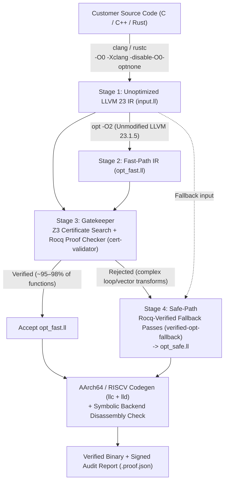

# Master Plan & Roadmap (`cert-llvm`)

**Target Baseline:** LLVM `23.1.5` (`llvmorg-23.1.5`, released 2026-11-03) + Vellvm (`main` on Rocq `9.1`)  
**Last Updated:** 2026-11-25

---

## Current Progress Snapshot

| Phase | Timeframe | Status | Completion |
| :--- | :--- | :--- | :--- |
| **Phase 1: Repository Setup & Minimal Build** | Weeks 1–2 | **Completed** | **100%** (1.1, 1.1b, 1.1c, 1.2 LLVM 23.1.5 SDK & Rocq 9.1 CI, and 1.3 Rust `ir-bridge` Done) |
| **Phase 2: Verified Fallback Core (Rocq)** | Months 1–3 | **Completed** | **100%** (2.1a, 2.1b, 2.2 5 Rocq passes + `Pipeline.v`, 2.3 `verified-opt-fallback` CLI + `ir-bridge` hardening, & `F-37` vector poison Done) |
| **Phase 3: Verified Translation Validator** | Months 3–6 | **Completed** | **100%** (3.1 `cert-v1` + `Z3` `QF_BV` engine, 3.2 Rocq `cert-validator` `779+` `Qed.` theorems, & 3.3 loop cut-points / 64-bit GEP / SROA slot forwarding Done) |
| **Phase 4: Orchestration, Backend Check & Audit** | Months 6–9 | **Completed** | **100%** (4.1a `cert-llvm` + `runtime/`, 4.1b Rocq [`ModuleMerge.v`](../passes/ModuleMerge.v), 4.2 `cert-backend-check`, & 4.3 Ed25519 `.proof.json` Done) |
| **Phase 5: Two-Stage Hardening & Assurance** | Continuous | **Completed** | **100%** ([`CheckAssumptions.v`](../validator/CheckAssumptions.v) `0` custom axioms [`AigLrat` closed; 5 upstream Vellvm 3.0 classical axioms gated], [`run_forged_cert_suite.py`](../scripts/run_forged_cert_suite.py) 34/34 + Wycheproof, 4-Persona Red-Team `68/68` + `22/22` `resolved`, & Stage B `cert-qual-suite` Done) |
| **Phase 6: E2E Provability, Stage 4b LRAT & OCaml Assurance** | Post-v1 | **In Progress** | **6.0, 6.1, 6.2, 6.3a, 6.4a Done** (Wave 2 live E2E `8/8` `mc` & `4/7` `full`, Stage 3/4b LRAT, dual-compiler `34/34` forged + `230/230` mutation gate, `--require-mc-validated`); **6.4b ISA-QEMU Fuzzing Next**; **6.3b & 6.4c Planned** |
| **Phase 8.3a: Hybrid Rocq ELF/MC Validator *(Pulled Forward)*** | Post-v1 | **In Progress (M1, M2, M2b, M3a & M3b Done; M3c -> M4 Next)** | **Closes Stage 4b TCB:** M1 `RV64IM+RVC` & M2 `AArch64` Core (`8/8` live `.o`+`.elf`, `32` pos + `35` adv, **Stage 1** QEMU oracle) + **M2b Stage 2** formal Sail oracles (**`298`** A64 + **`149`** RV64/RVC opcodes proven over $2^{64}/2^{128}/2^{192}$ via `isla_batch`+`Z3`, `8/8` mutations, **`1,447`** `armv9_sim` + **`3,065`** `sail_riscv_sim` cases, `0`-axiom div/rem bridge) + **M3a** stack-frames & **M3b** structured loops Done (commit `49a902e`, [`McLoop.v`](../validator/McLoop.v), `64` pos + `64` adv checks, `0 Admitted`); M3c (calls) -> **M4** Rocq cleanup (modularization/formatting, layered deterministic tactic library, build/checker performance, granular error-pointing, Spec/Proof auditability) next; Stage 3 in Phase 9 |
| **Phase 7: 32-Bit Targets (`ILP32`, `RV32`, `Thumb-2`/`A32`)** | Post-v1 | **Planned *(After 8.3a)*** | Shared `ILP32` parameterization (~2.5k–3.5k LOC) -> `RISCV32` (~0.8k–1.2k LOC) -> `ARM Thumb-2` / `A32` (~3.5k–5.0k LOC), inheriting `.mc.cert` / `McValidator.v` |
| **Phase 8 (Remaining): Deep Rocq Closure (`volatile`, `.bc`, `8.3b`)** | Post-v1 | **Planned** | Observable `volatile`/MMIO & verified `runtime/` (`8.1`) -> Rocq `.bc` codec (`8.2`) -> optional 2-tier private certifying fallback codegen (`llc -O0` retry + canonical `.mc.cert` emitter checked by public `8.3a`, `8.3b`) |
| **Phase 9: Regulatory TQK, Concept Assessment & Frontends** | Post-v1 | **Planned** | `ISO 26262-8` Concept Assessment/`TQK`, Stage-1 `SuperTest`/`FLS` traceability -> unified AbsInt-free `vellvmgen` hub (clean-room `Clang -> Clight`/VST for C & `MiniRust`/`Charon` for Rust `Source -> Vellvm` TV), & Stage-3 Sail Coq refinement |

---

## 1. System Architecture: The 4-Stage Pipeline Model

`cert-llvm` orchestrates compilation **per function** to combine full `-O2` speed with mathematical soundness:

> **Current Assurance Boundary (After Wave 2):** Stage 2–3 IR refinement (`input.ll -> merged.ll`), module-merge composition (`ModuleMerge.v`), and Stage 4b `--check-lrat` SAT/UNSAT discharge (`AigLrat.v`) are formally proven in Rocq (`0 Admitted`, `0` custom axioms). The Rust ELF64 parser, A64/RV64 decoders, symbolic executor, and bit-blasting encoder in `cert-backend-check` remain outside the Rocq kernel today; closing that final link via `cert-validator --check-mc` is the exact scope of pulled-forward **Phase 8.3a**.

1. **Stage 1 — Frontend (Clean Unoptimized IR):** `clang` or `rustc` compiles customer code with `-O0 -Xclang -disable-O0-optnone` into clean, unoptimized LLVM 23 IR (`input.ll`).
2. **Stage 2 — Fast-Path (Unmodified LLVM 23 `-O2`):** Upstream `opt` optimizes `input.ll` at full speed into `opt_fast.ll`.
3. **Stage 3 — Gatekeeper (Verified Rocq Translation Validator):**
   - An untrusted SMT solver (`Z3`) searches for a semantic equivalence proof between `input.ll` and `opt_fast.ll` and emits a machine-checkable proof certificate (`.cert`).
   - `cert-validator` (100% formally proven in Rocq and extracted to OCaml) checks the certificate against Vellvm semantics.
   - **Pass (~95–98% of functions):** `opt_fast.ll` is accepted.
   - **Fail:** `opt_fast.ll` is discarded.
4. **Stage 4 — Safe-Path (Verified Rocq Fallback Core):** Rejected functions fall back to `input.ll` and pass through `verified-opt-fallback` (core optimization passes written and proven directly in Rocq, producing `opt_safe.ll`), followed by `AArch64` or `RISCV` machine code emission and audit logging.

---

## 2. Technology Stack

| Component | Tool / Baseline | Role in System | License |
| :--- | :--- | :--- | :--- |
| **Compiler Base** | LLVM `23.1.5` (`llvmorg-23.1.5`) | Delivers `clang`, high-speed `opt`, linker `lld`, and `AArch64` & `RISCV` backends | `Apache-2.0 WITH LLVM-exception` |
| **Formal IR Semantics** | Vellvm (`vellvm/`, Rocq `9.1`) | Defines mathematical semantics for LLVM IR instructions, memory provenance, opaque pointers, and poison/UB | `MIT` (`Numeric/`: `LGPL-2.1+`) |
| **Translation Validator** | Rocq + `Z3` / `CVC5` | `Z3` generates equivalence certificates; Rocq-proven `cert-validator` verifies certificates | `Z3`: `MIT`; Checker: `MIT`/`LGPL-3.0` |
| **Fallback Compiler Core** | Rocq Extraction to OCaml | 5–8 core passes (`mem2reg`, `sccp`, `dce`, `simplifycfg`, `inline`) proven in Rocq and compiled to `verified-opt-fallback` | Isolated CLI (`LGPL-3.0` compliant) |
| **Orchestration Driver** | Rust (`cert-llvm`) | Drop-in CLI replacement for `clang`/`opt`, splits modules into functions, drives Fast-Path vs. Safe-Path, signs `.proof.json` | **100% Proprietary** |
| **AI Proof Pipeline** | LLM Agents + `rocq-lsp` / `rocq top` | Automated proof synthesis & repair loop against the Rocq typechecker for Vellvm lemmas and validator rules | Internal Tooling |

See:
- [`post-v1-roadmap.md`](./post-v1-roadmap.md) — Post-v1 phases (**Weg A**: Phase `6.4b` ISA-QEMU fuzzing -> Phase `8.3a` Hybrid Rocq ELF/MC validator -> Phase `7` `ILP32`/`RV32`/`ARM Thumb-2` -> Phases `8.1`/`8.2`/`8.3b`/`9`).
- [`ocaml-validator-qualification.md`](./ocaml-validator-qualification.md) — `ISO 26262-8 §11` qualification evidence for OCaml `cert-validator` / `verified-opt-fallback`.
- [`licensing-and-boundaries.md`](./licensing-and-boundaries.md) — Mandatory commercial license isolation & subprocess boundaries.
- [`business-model-and-ip-strategy.md`](./business-model-and-ip-strategy.md) — CompCert-style Dual-License & Open-Core 2-repository split (`llvm-cert` + private `llvm-cert-enterprise`).
- [`code-quality-and-ci.md`](./code-quality-and-ci.md) — "MISRA-Grade" Rust, Mathematical Rocq, CERT C / MISRA C, Minimal-OCaml (`<= 750 LOC`), and optimized multi-tier CI (`mold`, `cargo-nextest`, `Swatinem/rust-cache`, `ccache`).
- [`rocq-proof-strategies.md`](./rocq-proof-strategies.md) — Fast-compute Rocq 9.1 & Vellvm 3.0 proof playbook (`[PS-01]`..`[PS-08]`).
- [`hardening-and-assurance-strategy.md`](./hardening-and-assurance-strategy.md) — Two-stage, 4-layer security, soundness, forged-certificate, and QEMU differential assurance strategy.
- [`dev-and-verification-workflow.md`](./dev-and-verification-workflow.md) — Day-to-day development, local Docker Rocq `9.1` verification, CI trigger rules, and release-bundle runbook.
- [`feedback.csv`](./feedback.csv) — Structured agent audit & findings ledger (`F-XX`).

---

## 3. Implementation & Hardening Roadmap

### Phase 1: Repository Setup & Minimal Build (Weeks 1–2)

- [x] **1.1 Freeze & Prune LLVM 23.1.5 Baseline:**
  - Pinned exact release tag `llvmorg-23.1.5` (`392dfff97d29b59d77e5cac6d4b6ef2585fe7117`), zero Git history.
  - Pruned repository from 180,650 files to 11,776 files (kept `llvm`, `clang`, `lld`, `cmake`, full backends `AArch64` & `RISCV`, plus minimal header/TableGen dependencies).
  - Verified CMake + Ninja configuration and `LLVMTargetParser` / `LLVMSupport` build targets.
- [x] **1.1b Clean Vellvm Import & License Sanitization *(pulled forward)*:**
  - Imported Vellvm (`main`, Rocq 9.1, including restored `src/rocq/Theory/`) into [`../vellvm/`](../vellvm).
  - Stripped all `GPL-3.0+` driver files and `GPL-2.0+` `Camlcoq.ml`; synced `Zbits.v` with upstream CompCert `LGPL-2.1+` and added a clean-room MIT [`Camlcoq.ml`](../vellvm/src/ml/libvellvm/Camlcoq.ml).
- [x] **1.1c Commercial Dual-License, Private Enterprise Repo & Quality/CI Gates *(pulled forward)*:**
  - Adopted CompCert-style Dual-License in [`../LICENSE`](../LICENSE) and provisioned private [`mannomannX/llvm-cert-enterprise`](https://github.com/mannomannX/llvm-cert-enterprise) (`D:\LLVMCert-Enterprise`) with High-Assurance Rust lints, `deny.toml`, `mold`, `cargo-nextest`, and `Swatinem/rust-cache`.
  - Added read-only integrity gate [`../scripts/verify_repo_integrity.py`](../scripts/verify_repo_integrity.py), CERT C baseline [`../c-quality/`](../c-quality), agent rules (`AGENTS.md`, `.agents/skills/rocq-proof-engineering`), [`feedback.csv`](./feedback.csv), [`rocq-proof-strategies.md`](./rocq-proof-strategies.md), and 3-tier GitHub Actions CI.
- [x] **1.2 Server-Optimized Release Build & Rocq Toolchain Verification:**
  - Verified `llvm-toolchain-build.yml` green on GitHub Actions (run `42958598728`, `33m14s` cold build), producing the stripped Release `clang`, `opt`, `lld`, `llc`, `llvm-as`, `llvm-dis`, `llvm-extract`, and `llvm-objdump` SDK (`AArch64;RISCV`) and warming `ccache`.
  - Verified `rocq-ci.yml` green on GitHub Actions (run `42959607954`, `9m05s`), compiling all 87 `.v` files, OCaml extraction, `libvellvm`, and `rocq check -o` end-to-end on Rocq `9.1`.
- [x] **1.3 Fix LLVM 23 <-> Vellvm Surface Interface in Rust ([`../ir-bridge/`](../ir-bridge)):**
  - Implemented High-Assurance **Rust** IR bridge (`ir-bridge/`, zero handwritten OCaml, `unsafe_code = "forbid"`) handling bitwise IEEE-754 normalization of LLVM 23 `f0x<hex>` / `±inf` / `±s?nan` FP literals to `0x<hex>`, `/* immarg */` & debug stripping, Fast-Path soundness eligibility checks (`F-08`, `F-15`), `GlobalOpt`/`GlobalDCE`-safe per-function `split`, and header-restoring / `#N` & `!N` re-indexing `merge`.

---

### Phase 2: Verified Rocq Fallback Core (Months 1–3)

> **Baseline Note:** Ground-truth audit of [`LLVMAst.v`](../vellvm/src/rocq/Syntax/LLVMAst.v), [`llvm_parser.mly`](../vellvm/src/ml/libvellvm/llvm_parser.mly), and [`Operations/`](../vellvm/src/rocq/Semantics/Operations) confirmed that Vellvm 3.0/`main` already parses Opaque Pointers (`TYPE_Pointer None`), `zext nneg`, `or disjoint`, `trunc nuw/nsw`, `icmp samesign`, `gep inbounds/nusw/nuw`, `ptrtoaddr`, `captures(...)`, and `b<N>` byte types. Core poison-flag semantics (`trunc nuw/nsw`, `zext nneg`, `uitofp nneg`, `icmp samesign`) and `"bfloat"` lexing/parsing are now closed (`F-08`), while pointer/`iptr` `icmp samesign` and `bfloat`/`fp128` value ops remain soundly routed to Safe-Path (`F-15`).

- [x] **2.1a Close Vellvm 3.0 Conversion/Compare Poison Holes & Lexer Gaps (`F-08`):**
  - Implemented exact poison semantics and kernel-checked `Qed.` lemmas for `trunc nuw/nsw`, `zext nneg`, and `uitofp nneg` in [`Conversion.v`](../vellvm/src/rocq/Semantics/Operations/Conversion.v), forwarded `samesign` in [`Compare.v`](../vellvm/src/rocq/Semantics/Operations/Compare.v), added `"bfloat"` (`KW_BFLOAT`) to [`llvm_lexer.mll`](../vellvm/src/ml/libvellvm/llvm_lexer.mll) / [`llvm_parser.mly`](../vellvm/src/ml/libvellvm/llvm_parser.mly), and preserved `I2F` (`Theory/I2F/I2F_exp.v`) while gating bare-metal MMIO pointer `icmp samesign` (`F-15`).
- [x] **2.1b Target-Specific `fp128` Gate & 98 Pure Intrinsic Extensions:**
  - Routed non-IEEE-32/64 floating-point types (`half`, `bfloat`, `fp128`, `x86_fp80`, `ppc_fp128`) deterministically to the Safe-Path pass-through in [`vellvm_sanitize.rs`](../ir-bridge/src/vellvm_sanitize.rs) (avoiding a high-risk invasive fork of Vellvm's `DynamicTypes`/`MemoryBytes` `dvalue` core while keeping `f32`/`f64` on the Fast-Path).
  - Implemented and proved `I2F` refinement for 98 pure LLVM 23 intrinsics (`10` `f32`/`f64` floating-point + `88` width-indexed `i8`/`i16`/`i32`/`i64` bit-manipulation, saturating, min/max, abs, and overflow intrinsics) across [`IntrinsicsDefinitions.v`](../vellvm/src/rocq/Semantics/IntrinsicsDefinitions.v) and [`I2F_interp.v`](../vellvm/src/rocq/Theory/I2F/I2F_interp.v).
- [x] **2.2 Implement & Prove 5 Core Optimization Passes in Rocq ([`../passes/`](../passes)):**
  - Built [`PassCommon.v`](../passes/PassCommon.v): axiom-free whole-module semantic refinement framework (`prog_refines`, provenance-aware `refine_prov`, per-CFG `lift_cfg_pass`, and local-state `lift_cfg_with_args_local_pass` / `lift_cfg_local_pass`).
  1. `mem2reg` ([`Mem2Reg.v`](../passes/Mem2Reg.v)) — Promotes non-escaping scalar `alloca` stack slots + `load`/`store`s into SSA registers and `phi` nodes.
  2. `sccp` ([`SCCP.v`](../passes/SCCP.v)) — Sparse Conditional Constant Propagation over SSA definitions and executable CFG edges.
  3. `dce` ([`DCE.v`](../passes/DCE.v)) — Liveness-driven Dead Code Elimination for side-effect- and failure-free instructions and `phi` nodes.
  4. `simplifycfg` ([`SimplifyCFG.v`](../passes/SimplifyCFG.v)) — Constant branch/switch folding, unreachable block & dead `phi`-edge pruning, and single-predecessor block coalescing.
  5. `inline` ([`Inline.v`](../passes/Inline.v)) — Bounded multi-round call-site inlining with fresh SSA/block α-renaming and block splitting.
  - Composed all passes via [`Pipeline.v`](../passes/Pipeline.v) (`optimize_mcfg_refines`, `0 Admitted`, verified by `rocq check -o`) and wired OCaml extraction in [`Extract.v`](../vellvm/src/ml/extracted/Extract.v).
- [x] **2.3 Extract Standalone `verified-opt-fallback` Binary & Harden `ir-bridge` Boundary:**
  - Built [`McfgExport.v`](../passes/McfgExport.v) (`0 Admitted`, verified entry-block placement + fail-fast `reify_dtyp` + `#N`/`!N` & `TYPE_Function` prototype preservation) and compiled the standalone CLI binary [`verified_opt_fallback.ml`](../vellvm/src/ml/bin/verified_opt_fallback.ml) (`input.ll -> opt_safe.ll`).
  - Added `proptest` (3,584 cases across 7 fallible suites, fixing 128-bit `0xL<low64><high64>` word order `F-29`), differential `llvm-as` bitcode round-trip checks, and `#[cfg(kani)]` bounded model-checking harnesses on [`../ir-bridge/`](../ir-bridge).

---

### Phase 3: Verified Translation Validator (Months 3–6)

- [x] **3.1 Certificate Format & SMT Certificate Generator (`Z3`):**
  - Implemented deterministic canonical S-expression `.cert` (`cert-v1`) schema ([`cert.rs`](../../LLVMCert-Enterprise/crates/cert-z3-engine/src/cert.rs), including `entry`/`cutpoint`/`return` block structure, FIPS 180-4 SHA-256 digests, UB assumptions, SSA equivalences, and memory slot refinements) with `0` external crate dependencies.
  - Built the Alive2-style `(bv, poison)` + `reach` + `ub` `QF_BV` SMT-LIB2 encoder and `Z3` witness generator ([`smt.rs`](../../LLVMCert-Enterprise/crates/cert-z3-engine/src/smt.rs), [`ir_model.rs`](../../LLVMCert-Enterprise/crates/cert-z3-engine/src/ir_model.rs)) verified end-to-end against live `Z3` and pure-Rust `QF_BV` boundary tests.
- [x] **3.2 100% Rocq-Proven Proof Checker (`cert-validator`):**
  - Implemented and proved [`CertFormat.v`](../validator/CertFormat.v), [`AigLrat.v`](../validator/AigLrat.v), [`AlgRules.v`](../validator/AlgRules.v), and [`CertValidator.v`](../validator/CertValidator.v) (`34,917` LOC, `779` `Qed.` theorems, `0 Admitted`, `AigLrat` closed & `0` custom axioms beyond upstream Vellvm 3.0): total `cert-v1` parser + syntax/prototype contract gates (`F-17`, `F-18`, `F-19`, `F-21`, `F-30`..`F-34`), 2-rail `(val, poison)` AIG+LRAT checker, algebraic normalizer, and open-world `CallE` (`F-33`) + relational `DrawE` (`F-44`) CFG refinement validator (`validate_tle_pair_with_cert_str_sound`), extracted to standalone CLI [`cert_validator.ml`](../vellvm/src/ml/bin/cert_validator.ml).
- [x] **3.3 Iterative Rule Expansion (Loops, 64-Bit Modular GEP & SROA/Stack Forwarding):**
  - Implemented 3-step inductive loop cut-point & `K <= 16` unrolling synthesis (`loop_cert.rs`, `E-20`) + Rocq soundness (`check_loop_cutpoint_cfg_open_sound` preserving $\tau^\omega$ non-termination, `F-26`), 64-bit modular `getelementptr` reassociation (`Gep.v` + `gep_chained_no_flags_reassoc_sound`, `F-46`), padded-aggregate SROA/slot forwarding (`MemoryBytesFacts.v` + `check_memory_invariant_valid_sound`, `F-48`), and target NaN profiles (`Archi.v`, `F-39`).

---

### Phase 4: Orchestration, Backend Assurance & Productization (Months 6–9)

- [x] **4.1a Rust Orchestrator (`cert-llvm`) & Freestanding MISRA/CERT C Runtime:**
  - Built pure-`std` 4-stage CLI orchestrator (`cert-llvm` in `llvm-cert-enterprise`, `0` external crates) supporting deterministic `--jobs=N` per-function parallel scheduling (`opt -O2` + `Z3` + `cert-validator` Fast-Path with fail-closed `verified-opt-fallback` Safe-Path), locked `SafetyDriverProfile`, and freestanding [`../runtime/`](../runtime/include/cert_runtime.h) builtins (`F-27`, `E-14`).
- [x] **4.1b Rocq-Checked Split/Merge Boundary (`check_module_merge`):**
  - Implemented and proved [`ModuleMerge.v`](../passes/ModuleMerge.v) (`8,869` lines, `262` `Qed.` theorems, `0 Admitted`, `0` custom axioms beyond upstream Vellvm 3.0): decidable `check_module_merge` / `validate_module_merge_parsed` (with bidirectional `METADATA_File_info` span normalization), proving global/alignment/declaration stability (`F-33`, `F-47`), prototype contract preservation (`F-19`), open-world `CallE` compositional whole-module refinement (`check_module_merge_refines` & `check_module_merge_I2F_model_refine`), and heterogeneous TV + Safe-Path `Pipeline.optimize_mcfg` splicing (`F-20`, `F-24`).
- [x] **4.2 Symbolic Backend Checker (IR-to-Assembly for `AArch64` & `RISCV`):**
  - Implemented pure-`std` [`cert-backend-check`](../../LLVMCert-Enterprise/crates/cert-backend-check/src/lib.rs) (`0` external crates): bounds-checked ELF64 `EM_AARCH64` & `EM_RISCV` inspector, `F-27` `R_RISCV_RELAX`/`R_RISCV_ALIGN` & call-relocation allowlist gate, A64 & `RV64IMAFDC`+`RVC` decoders, 16B-`sp`/callee-saved/`.stack_sizes`/`F-32` `sret` (`x8` vs `a0`) ABI gates, and 3-tier `QF_BV` post-IR-to-MC symbolic equivalence upgrading proven functions to `McValidated` (`E-18`).
- [x] **4.3 Cryptographically Signed Customer Audit Report (`.proof.json`):**
  - Implemented deterministic `cert-llvm-proof-v1` verification manifests (`unproven_ir_optimizations: 0`, full artifact/CLI/datalayout/8-tool SHA-256 bindings, ELF64/assembly `.stack_sizes` frame accounting, RFC 8032 Ed25519 signing & round-trip verification, and atomic file emission) in [`cert-attestation`](../../LLVMCert-Enterprise/crates/cert-attestation/src/lib.rs) and [`orchestrator.rs`](../../LLVMCert-Enterprise/crates/cert-llvm/src/orchestrator.rs), backed by 5,000-case property sweeps and `#[cfg(kani)]` harnesses (`E-01`, `E-05`, `E-06`, `E-13`, `E-14`).

---

### Phase 5: Two-Stage Hardening & Continuous Assurance ([`hardening-and-assurance-strategy.md`](./hardening-and-assurance-strategy.md))

- [x] **5.1 Stage A — Zero-Axiom TCB Gate, Forged-Cert/Wycheproof Suites & 4-Persona Red-Team:**
  - **Layer 1:** Discharged all custom/library `Axiom` declarations (`F-05`, `ALLOWED_ROCQ_AXIOMS = set()`) and enforced exact per-layer `Print Assumptions` subset gates via [`CheckAssumptions.v`](../validator/CheckAssumptions.v) in `rocq-ci.yml` (green in Run `44586271407`): `AigLrat.check_lrat_unsat_sound` is `"Closed under the global context"`, `AlgRules`/`CertValidator` depend only on 4 upstream stdlib classical axioms (no `eq_rect_eq`), and `Pipeline`/`ModuleMerge` add `0` custom axioms beyond upstream `Vellvm.Theory.I2F.I2F_toplevel.model_refine`.
  - **Layer 2:** Built 28-case [`run_forged_cert_suite.py`](../scripts/run_forged_cert_suite.py) (`28/28` live pass on `cert-validator` & `verified-opt-fallback` in Run `44586271407`) + Wycheproof Ed25519 & 43-vector CLI/manifest security suites (`cert-attestation` / `cert-llvm`).
  - **Layer 4:** Completed all 4 domain-isolated Red-Team persona audits (`F-50`..`F-68` & `E-15`..`E-22`), remediating 100% of findings (`68/68` public + `22/22` enterprise entries `resolved`) with permanent CI regression tests.
- [x] **5.2 Stage B — Differential Execution Fuzzing, Embedded Safety Corpus & `ISO 26262` / `DO-330` Qualification Suite (`E-19`):**
  - **Layer 3a:** Built [`cert-qual-suite`](../../LLVMCert-Enterprise/crates/cert-qual-suite/src/lib.rs) (`0` external crates): seeded UB-free scalar & diamond-CFG IR fuzzer ([`fuzzer.rs`](../../LLVMCert-Enterprise/crates/cert-qual-suite/src/fuzzer.rs)), delta-debugging reducer ([`reduce.rs`](../../LLVMCert-Enterprise/crates/cert-qual-suite/src/reduce.rs)), 4-way differential oracle (`ir_interp` + live `Z3` `cert-v1` + concrete `AArch64` & `RISC-V+RVC` ELF64 executors + `cert-backend-check`), and 3-way `QEMU` harness ([`qemu.rs`](../../LLVMCert-Enterprise/crates/cert-qual-suite/src/qemu.rs)).
  - **Layer 3b:** 20 license-clean embedded safety kernels ([`corpus.rs`](../../LLVMCert-Enterprise/crates/cert-qual-suite/src/corpus.rs): `100%` Fast-Path on eligible acyclic kernels, `90%` `McValidated`, `<= 256`B stack bound), `.proof.json` telemetry gates ([`telemetry.rs`](../../LLVMCert-Enterprise/crates/cert-qual-suite/src/telemetry.rs)), and 10-case `ISO 26262 TCL3` / `DO-330 TQL-1` fault-injection suite (`100%` mutation kill rate, [`qualification.rs`](../../LLVMCert-Enterprise/crates/cert-qual-suite/src/qualification.rs)).

