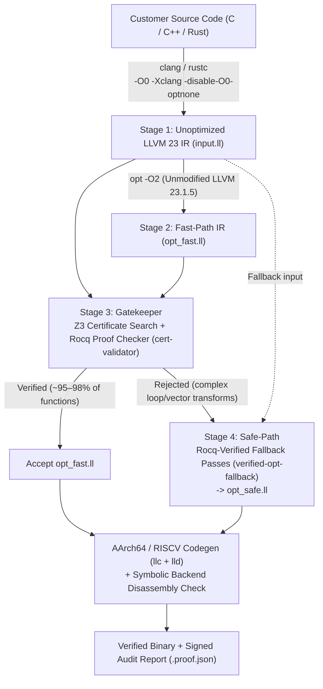

# Master Plan & Roadmap (`cert-llvm`)

**Target Baseline:** LLVM `23.1.5` (`llvmorg-23.1.5`, released 2026-11-03) + Vellvm (`main` on Rocq `9.1`)  
**Last Updated:** 2026-11-11

---

## Current Progress Snapshot

| Phase | Timeframe | Status | Completion |
| :--- | :--- | :--- | :--- |
| **Phase 1: Repository Setup & Minimal Build** | Weeks 1–2 | **In Progress** | **~90%** (1.1, 1.1b, 1.1c & 1.3 Rust `ir-bridge` Done; 1.2 LLVM 23.1.5 SDK & Rocq 9.1 CI running) |
| **Phase 2: Verified Fallback Core (Rocq)** | Months 1–3 | Not Started *(Foundation Ready)* | **~10%** (Vellvm 3.0/`main` already includes Opaque Pointers `TYPE_Pointer None` & `Theory/`) |
| **Phase 3: Verified Translation Validator** | Months 3–6 | Not Started | **~5%** (`cert-z3-engine` & `cert-llvm` Rust workspace scaffolded in `llvm-cert-enterprise`) |
| **Phase 4: Orchestration, Backend Check & Audit** | Months 6–9 | Not Started | **~10%** (`cert-attestation` `.proof.json` schema & unit tests scaffolded in `llvm-cert-enterprise`) |

---

## 1. System Architecture: The 4-Stage Pipeline Model

`cert-llvm` orchestrates compilation **per function** to combine full `-O2` speed with mathematical soundness:

1. **Stage 1 — Frontend (Clean Unoptimized IR):** `clang` or `rustc` compiles customer code with `-O0 -Xclang -disable-O0-optnone` into clean, unoptimized LLVM 23 IR (`input.ll`).
2. **Stage 2 — Fast-Path (Unmodified LLVM 23 `-O2`):** Upstream `opt` optimizes `input.ll` at full speed into `opt_fast.ll`.
3. **Stage 3 — Gatekeeper (Verified Rocq Translation Validator):**
   - An untrusted SMT solver (`Z3`) searches for a semantic equivalence proof between `input.ll` and `opt_fast.ll` and emits a machine-checkable proof certificate (`.cert`).
   - `cert-validator` (100% formally proven in Rocq and extracted to OCaml) checks the certificate against Vellvm semantics.
   - **Pass (~95–98% of functions):** `opt_fast.ll` is accepted.
   - **Fail:** `opt_fast.ll` is discarded.
4. **Stage 4 — Safe-Path (Verified Rocq Fallback Core):** Rejected functions fall back to `input.ll` and pass through `verified-opt-fallback` (core optimization passes written and proven directly in Rocq, producing `opt_safe.ll`), followed by `AArch64` or `RISCV` machine code emission and audit logging.

---

## 2. Technology Stack

| Component | Tool / Baseline | Role in System | License |
| :--- | :--- | :--- | :--- |
| **Compiler Base** | LLVM `23.1.5` (`llvmorg-23.1.5`) | Delivers `clang`, high-speed `opt`, linker `lld`, and `AArch64` & `RISCV` backends | `Apache-2.0 WITH LLVM-exception` |
| **Formal IR Semantics** | Vellvm (`vellvm/`, Rocq `9.1`) | Defines mathematical semantics for LLVM IR instructions, memory provenance, opaque pointers, and poison/UB | `MIT` (`Numeric/`: `LGPL-2.1+`) |
| **Translation Validator** | Rocq + `Z3` / `CVC5` | `Z3` generates equivalence certificates; Rocq-proven `cert-validator` verifies certificates | `Z3`: `MIT`; Checker: `MIT`/`LGPL-3.0` |
| **Fallback Compiler Core** | Rocq Extraction to OCaml | 5–8 core passes (`mem2reg`, `sccp`, `dce`, `simplifycfg`, `inline`) proven in Rocq and compiled to `verified-opt-fallback` | Isolated CLI (`LGPL-3.0` compliant) |
| **Orchestration Driver** | Rust (`cert-llvm`) | Drop-in CLI replacement for `clang`/`opt`, splits modules into functions, drives Fast-Path vs. Safe-Path, signs `.proof.json` | **100% Proprietary** |
| **AI Proof Pipeline** | LLM Agents + `rocq-lsp` / `rocq top` | Automated proof synthesis & repair loop against the Rocq typechecker for Vellvm lemmas and validator rules | Internal Tooling |

See:
- [`licensing-and-boundaries.md`](./licensing-and-boundaries.md) — Mandatory commercial license isolation & subprocess boundaries.
- [`business-model-and-ip-strategy.md`](./business-model-and-ip-strategy.md) — CompCert-style Dual-License & Open-Core 2-repository split (`llvm-cert` + private `llvm-cert-enterprise`).
- [`code-quality-and-ci.md`](./code-quality-and-ci.md) — "MISRA-Grade" Rust, Mathematical Rocq, CERT C / MISRA C, Minimal-OCaml (`<= 750 LOC`), and optimized multi-tier CI (`mold`, `cargo-nextest`, `Swatinem/rust-cache`, `ccache`).
- [`rocq-proof-strategies.md`](./rocq-proof-strategies.md) — Fast-compute Rocq 9.1 & Vellvm 3.0 proof playbook (`[PS-01]`..`[PS-08]`).
- [`feedback.csv`](./feedback.csv) — Structured agent audit & findings ledger (`F-XX`).

---

## 3. 4-Phase Implementation Plan & Task Checklist

### Phase 1: Repository Setup & Minimal Build (Weeks 1–2)

- [x] **1.1 Freeze & Prune LLVM 23.1.5 Baseline:**
  - Pinned exact release tag `llvmorg-23.1.5` (`392dfff97d29b59d77e5cac6d4b6ef2585fe7117`), zero Git history.
  - Pruned repository from 180,650 files to 11,776 files (kept `llvm`, `clang`, `lld`, `cmake`, full backends `AArch64` & `RISCV`, plus minimal header/TableGen dependencies).
  - Verified CMake + Ninja configuration and `LLVMTargetParser` / `LLVMSupport` build targets.
- [x] **1.1b Clean Vellvm Import & License Sanitization *(pulled forward)*:**
  - Imported Vellvm (`main`, Rocq 9.1, including restored `src/rocq/Theory/`) into [`../vellvm/`](../vellvm).
  - Stripped all `GPL-3.0+` driver files and `GPL-2.0+` `Camlcoq.ml`; synced `Zbits.v` with upstream CompCert `LGPL-2.1+` and added a clean-room MIT [`Camlcoq.ml`](../vellvm/src/ml/libvellvm/Camlcoq.ml).
- [x] **1.1c Commercial Dual-License, Private Enterprise Repo & Quality/CI Gates *(pulled forward)*:**
  - Adopted CompCert-style Dual-License in [`../LICENSE`](../LICENSE) and provisioned private [`mannomannX/llvm-cert-enterprise`](https://github.com/mannomannX/llvm-cert-enterprise) (`D:\LLVMCert-Enterprise`) with High-Assurance Rust lints, `deny.toml`, `mold`, `cargo-nextest`, and `Swatinem/rust-cache`.
  - Added read-only integrity gate [`../scripts/verify_repo_integrity.py`](../scripts/verify_repo_integrity.py), CERT C baseline [`../c-quality/`](../c-quality), agent rules (`AGENTS.md`, `.agents/skills/rocq-proof-engineering`), [`feedback.csv`](./feedback.csv), [`rocq-proof-strategies.md`](./rocq-proof-strategies.md), and 3-tier GitHub Actions CI.
- [ ] **1.2 (`TODO`) Server-Optimized Release Build & Rocq Toolchain Verification:**
  - Trigger `llvm-toolchain-build.yml` (or run on 12 GB server) to produce the prebuilt Release `clang`, `opt`, `lld`, `llc`, `llvm-as`, `llvm-dis`, `llvm-extract`, and `llvm-objdump` SDK (`AArch64;RISCV`).
  - Run `rocq-ci.yml` to verify `make -C vellvm/src` + `rocq chk` end-to-end on Rocq `9.1`.
- [x] **1.3 Fix LLVM 23 <-> Vellvm Surface Interface in Rust ([`../ir-bridge/`](../ir-bridge)):**
  - Implemented High-Assurance **Rust** IR bridge (`ir-bridge/`, zero handwritten OCaml, `unsafe_code = "forbid"`) handling bitwise IEEE-754 normalization of LLVM 23 `f0x<hex>` / `±inf` / `±s?nan` FP literals to `0x<hex>`, `/* immarg */` & debug stripping, Fast-Path soundness eligibility checks (`F-08`), `GlobalOpt`/`GlobalDCE`-safe per-function `split`, and header-restoring / `#N` & `!N` re-indexing `merge`.

---

### Phase 2: Verified Rocq Fallback Core (Months 1–3)

> **Baseline Note:** Ground-truth audit of [`LLVMAst.v`](../vellvm/src/rocq/Syntax/LLVMAst.v), [`llvm_parser.mly`](../vellvm/src/ml/libvellvm/llvm_parser.mly), and [`Operations/`](../vellvm/src/rocq/Semantics/Operations) confirms that Vellvm 3.0/`main` **already parses and prints** Opaque Pointers (`TYPE_Pointer None`), `zext nneg`, `or disjoint`, `trunc nuw/nsw`, `icmp samesign`, `gep inbounds/nusw/nuw`, `ptrtoaddr`, `captures(...)`, and `b<N>` byte types, **but leaves critical poison semantics unimplemented (`TODO`) in `Operations/Conversion.v` and `Operations/Compare.v`** (`F-08`).

- [ ] **2.1 (`TODO`) Close Vellvm 3.0 Soundness Holes & Complete LLVM 23.1.5 Semantics (`F-08`):**
  - Implement exact poison semantics for `trunc nuw/nsw`, `zext nneg`, and `uitofp nneg` in `Operations/Conversion.v:127,140,166` (currently `TODO` returning non-poison!) and fix pointer `icmp samesign` in `Operations/Compare.v:28-31`.
  - Add missing `"bfloat"` keyword to `llvm_lexer.mll` / `llvm_parser.mly`, evaluate `Flocq` `fp128` support for AArch64/RISC-V `long double`, and extend `IntrinsicsDefinitions.v` for target workloads.
- [ ] **2.2 (`TODO`) Implement & Prove 5 Core Optimization Passes in Rocq:**
  1. `mem2reg` — Promote stack allocations (`alloca` + `load`/`store`) into SSA registers (highest-impact pass).
  2. `sccp` — Sparse Conditional Constant Propagation.
  3. `dce` — Dead Code Elimination.
  4. `simplifycfg` — Control-Flow Graph simplification (dead blocks, constant branches, block merging).
  5. `inline` — Non-recursive / bounded function inlining.
- [ ] **2.3 (`TODO`) Extract Standalone `verified-opt-fallback` Binary:**
  - Extract proven Rocq passes to OCaml and compile into the standalone CLI tool `verified-opt-fallback` (`input.ll -> opt_safe.ll`).

---

### Phase 3: Verified Translation Validator (Months 3–6)

- [ ] **3.1 (`TODO`) Certificate Format & SMT Certificate Generator (`Z3`):**
  - Design a compact, deterministic proof certificate schema (`.cert`) capturing SSA value equivalence, memory state refinement, and UB/poison non-increase (Alive2-style encoding).
  - Build the untrusted `Z3`-backed certificate generator comparing `input.ll` and `opt_fast.ll` per function.
- [ ] **3.2 (`TODO`) 100% Rocq-Proven Proof Checker (`cert-validator`):**
  - Implement and prove soundness in Rocq against Vellvm's `Theory/Equational.v` & `Refinement.v`: if `check_cert fn_src fn_tgt cert = true`, then `fn_tgt` refines `fn_src`.
  - Extract to standalone native CLI binary `cert-validator`.
- [ ] **3.3 (`TODO`) Iterative Rule Expansion (AI-Assisted Proof Loop):**
  - Extend validator rules step-by-step for loop unrolling/rotation, alias/memory forwarding, and `AArch64`/`RISCV` vector idioms.

---

### Phase 4: Orchestration, Backend Assurance & Productization (Months 6–9)

- [ ] **4.1 (`TODO`) Rust Orchestrator (`cert-llvm`):**
  - Build the drop-in CLI driver (`cert-clang` / `cert-llvm`) accepting C, C++, and Rust inputs.
  - Split modules per function (`llvm-extract` / bitcode splitter), run Fast-Path + `cert-validator` in parallel, fall back seamlessly to `verified-opt-fallback` on rejection, and re-link verified functions.
- [ ] **4.2 (`TODO`) Symbolic Backend Checker (IR-to-Assembly for `AArch64` & `RISCV`):**
  - Implement a symbolic disassembler/MC equivalence check validating that emitted `AArch64` and `RISCV` machine instructions match the verified IR semantics.
- [ ] **4.3 (`TODO`) Cryptographically Signed Customer Audit Report (`.proof.json`):**
  - Emit a deterministic, signed per-build verification manifest (e.g., *"97.4% of functions verified via Fast-Path, 2.6% compiled via Rocq Fallback Core — 0 unproven transformations"*), ready for ISO 26262 / DO-178C / IEC 61508 qualification artifacts.

