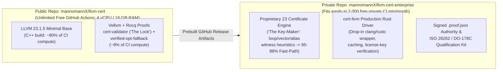

# Business Model, Open-Core Protection & GitHub Actions Strategy

This document defines how LLVMCert (`cert-llvm`) maximizes **free public GitHub Actions compute** and **academic/auditor trust** while preventing unauthorized commercial copying and building a defensible B2B safety-compiler business (modeled on **CompCert / AbsInt** and **Ferrocene**).

---

## 1. Dual-Licensing Model (CompCert / AbsInt Playbook)

All original LLVMCert components are distributed under a **Source-Available Dual License** ([`/LICENSE`](../LICENSE)):

1. **Non-Commercial Evaluation & Research License (Public GitHub Repo):**
   - Free for universities, researchers, security auditors, and a 30-day non-production technical evaluation.
   - **Strictly prohibits** compiling commercial products, internal business deployment, regulatory certification submissions (ISO 26262, DO-178C, IEC 61508), and hosted/SaaS verification or compilation services.
2. **Commercial Software License Agreement (Paid B2B Contract):**
   - Required for any company compiling production firmware/software or using `.proof.json` audit reports in safety/security compliance.
   - Automotive, aerospace, medical, railway, and defense companies have strict legal/compliance gates: **using an unlicensed Non-Commercial compiler invalidates safety certification and corporate liability coverage**.

---

## 2. Technical Anti-Cloning Moat: "Public Lock, Private Key-Maker"

A license file stops honest enterprises, **not** bad-faith clones. To keep **99% of heavy CI workloads on free public GitHub Actions runners** *without* giving away a turnkey product that anyone can copy, split the system along its natural mathematical asymmetry:

### Why Copycats Cannot Monetize a Clone of the Public Repo
1. **Checking Proofs Is Public ("The Lock"); Finding Proofs Is Private ("The Key-Maker"):**
   - The Rocq proof checker (`cert-validator`) in the public repo is compact and mathematically transparent—safety assessors *want* to inspect its soundness theorem!
   - However, `cert-validator` **only verifies certificates; it does not generate them**. Without the private Rust + Z3 **Certificate Generator** (loop-unrolling witness synthesis, alias-analysis hints, vectorization equivalence heuristics), a clone achieves **0% `-O2` Fast-Path acceptance** and degrades every function to slow basic fallback passes.
2. **CI Compute Asymmetry (Free GitHub Actions Leverage):**
   - Compiling LLVM 23 C++ (`clang`, `opt`, `lld`) and typechecking Rocq `.v` files consume **~99% of build time and RAM**. Keeping them in the public `llvm-cert` repository unlocks **unlimited free GitHub Actions minutes** on public runners (`ubuntu-latest`: 4 vCPU, **16 GB RAM** — faster and larger than a 12 GB VPS) and free GitHub Releases artifact hosting.
   - The private `mannomannX/llvm-cert-enterprise` repository (`D:\LLVMCert-Enterprise`) contains **only lightweight Rust code** (`cert-llvm` CLI, Z3 witness generator, cryptographic `.proof.json` signer) that downloads prebuilt LLVM + Rocq binaries from `llvm-cert` Releases and compiles in **< 30 seconds**, staying well within GitHub's free private runner quota.
3. **Cryptographic Vendor Attestation & Qualification Kit:**
   - Safety customers do not just buy an executable; they buy **vendor-backed Tool Qualification Packages** (ISO 26262 TCL3, IEC 61508 T3, DO-178C TQL-1) and `.proof.json` audit reports signed by your official vendor key + reproducible compiler hashes. An unauthorized fork cannot issue valid vendor-attested compliance certificates for TÜV / FAA / EASA audits.

---

## 3. Commercial Revenue Streams

| Tier | Target Customer | Included Deliverables | Pricing Model (Benchmark) |
| :--- | :--- | :--- | :--- |
| **Academic / Evaluation** | Researchers, universities, 30-day POCs | Public repo source (`llvm-cert`) + time-limited evaluation binary | **€0** (Non-Commercial License) |
| **Commercial Pro** | High-assurance embedded, crypto, fintech, robotics | Full `cert-llvm` Rust driver (`C`/`C++`/`Rust` -> `AArch64`/`RISCV`), private Z3 Fast-Path engine, CI runner licenses, unsigned/local `.proof.json` logs | **Annual subscription per developer seat / CI node** |
| **Enterprise Safety & Qualification** | Automotive (ISO 26262 ASIL-D), Avionics (DO-178C), Industrial (IEC 61508), Defense | Everything in Pro + **Tool Qualification Kit (QSK)**, vendor-signed `.proof.json` audit trail, LTS pinning on `LLVM 23.1.5`, priority SLA | **Annual enterprise contract per project / target architecture** (CompCert/Ferrocene market standard: €15k–€75k+/yr) |

