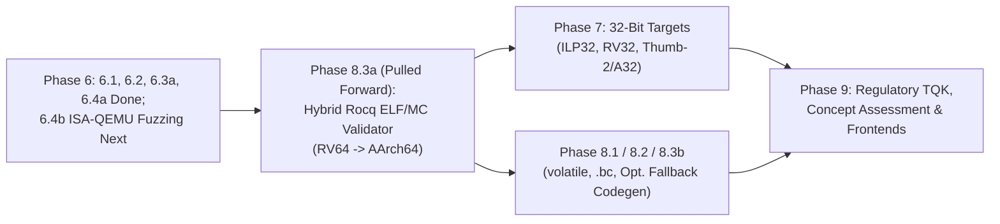

# Post-v1 Roadmap (`cert-llvm` Phases 6–9)

**Baseline:** Phases 1–5 Complete ([`README.md`](./README.md)); Wave 1–2 Live E2E Active (`rocq-ci.yml` Run `45237979180` at commit `c370e27`, `quality-gate.yml` Run `45237976937`, cross-repo `live-e2e.yml` Run `45240825208`: `8/8 (100.0%)` `mc` & `4/7 (57.1%)` `full` `fast_path_rocq_validated` + `mc_validated` on `aarch64` & `riscv64`, `EXACT (ocamlopt==ocamlc)`, `3-WAY MATCH` QEMU, `0` unproven IR optimizations)  
**Last Updated:** 2026-11-25

This roadmap defines the complete multi-phase plan closing remaining end-to-end verification, backend TCB closure, toolchain assurance, 32-bit targets, deep Rocq formalization, and regulatory qualification gaps beyond the v1 Middle-End baseline.

---

## Overview & Dependencies (**Weg A Execution Order**)

| Phase | Scope | Key Risk / TCB Closed | Dependency |
| :--- | :--- | :--- | :--- |
| **Phase 6** | **6.1, 6.2, 6.3a, 6.4a Done** (`live-e2e.yml`, LRAT Stage 3/4b, dual-compiler `34/34` forged + `230/230` mutation gate, `--require-mc-validated`); **6.4b** ISA-vs-QEMU fuzzing next; **6.3b** (`bisect_ppx`) & **6.4c** (Wave 3 `7/7` `full`) planned | Separates real LLVM `23.1.5` `-O2` telemetry; eliminates unchecked `Z3` UNSAT verdicts; qualifies `ocamlopt` output; hardens Rust ISA decoders before `8.3a` | Builds directly on v1 artifacts |
| **Phase 8.3a *(Pulled Forward)*** | **Hybrid Rocq ELF-to-IR Backend Validator (`cert-validator --check-mc`)**: `RV64IM+RVC` (`sail-riscv` reference) -> `AArch64` Core -> M3 stack/loops/calls -> **M4 Rocq cleanup** (modularization, shared tactics, formatting, performance, diagnostics & Spec/Proof auditability) | **Closes the last backend TCB gap:** removes ELF parser, A64/RV64 decoder, symbolic executor, and bit-blaster from the correctness TCB; prepares clean auditable modules ahead of Phase 7 | Phase `6.2` LRAT + `6.4b` ISA fuzzing |
| **Phase 7** | `ILP32` core parameterization, `RISCV32` (`RV32IMAC`/`RV32GC`), `ARM Thumb-2` (`Cortex-M`/`R`) & optional `A32` | Unlocks 32-bit safety microcontrollers (`ELFCLASS32`, `SHT_REL`/`SHT_RELA`, 64-bit freestanding builtins) directly inheriting the `.mc.cert` + `McValidator.v` architecture | Phase `8.3a` vertical slice |
| **Phase 8 (Remaining)** | **8.1** Rocq `volatile`/MMIO ITree + verified `runtime/`, **8.2** Rocq `.bc` codec, **8.3b** optional minimal fallback codegen (commercial/private add-on evaluation) | Eliminates Menhir/Ocamllex, text `ir-bridge`, runtime C, and optionally `llc`/`ld.lld` fallback paths | Phase `8.3a` |
| **Phase 9** | Tool Qualification Kit (`TQK`), Concept Assessment, unified AbsInt-free `Vellvm`/`vellvmgen` frontend hub (`Clang -> Clight`/VST for C & `MiniRust`/`Charon` for Rust), long-term Rust extraction evaluation | Audit-ready `ISO 26262-8` (`TCL3`/`ASIL D`), `IEC 61508` (`T3`/`SIL 3/4`), and `DO-178C`/`DO-330` compliance | Phase 6 + Phase `8.3a` (+ `8.3b` for `DAL A` OCV replacement) |

---

## Phase 6 — End-to-End Provability, Stage 4b TCB Closure & OCaml Validator Qualification

### 6.1 Cross-Repo Real-Toolchain E2E Verification Harness (`llvm-cert-enterprise`) *(Done)*
- **Outcome:** Live 8-binary pipeline (`clang 23` -> `opt 23 -O2` -> private SMT witness engine -> `cert-validator` / `verified-opt-fallback` -> `llc`/`ld.lld` -> `cert-backend-check` -> `.proof.json` -> `qemu-aarch64` / `qemu-riscv64`) verified in `live-e2e.yml` Run `45240825208`:
  - `e2e_corpus_mc.c` (`-O2`): **8/8 (100.0%)** `fast_path_rocq_validated` and **8/8 (100.0%)** `mc_validated` on both `aarch64` and `riscv64`, `EXACT (ocamlopt==ocamlc)`, `3-WAY MATCH` QEMU, `0` unproven IR optimizations.
  - `e2e_corpus_full.c` (`-O2`): **4/7 (57.1%)** `fast_path_rocq_validated` (`@voter_median3_i32`, `@helper_scale_i32`, `@saturating_add_u32`, `@pack_sensor_u64`) and **4/7 (57.1%)** `mc_validated`, strict `--require-mc-validated` fail-closed rejection verified, `EXACT (ocamlopt==ocamlc)`, `3-WAY MATCH` QEMU.

### 6.2 Eliminate Unchecked `Z3` from Stage 4b & Wire External LRAT Proofs in Stage 3 *(Done)*
- **Outcome:** Implemented total fail-closed DIMACS/LRAT verification (`validator/CertFormat.v`, `validator/AigLrat.v` `"Closed under the global context"`, CLI `--check-lrat` and Stage-3 `(lrat ...)` witness blocks within the `728/750` LOC handwritten OCaml TCB budget). Upgraded Stage 4b Tier 3 (`cert-backend-check`) to emit and verify machine-checkable UNSAT LRAT certificates via `cert-validator --check-lrat`. Zero paths rely on unchecked `Z3` `Unsat` verdicts.

### 6.3 OCaml Validator Toolchain Assurance (`ISO 26262-8 §11`)
Detailed technical baseline documented in [`ocaml-validator-qualification.md`](./ocaml-validator-qualification.md).
- **6.3a Dual-Compiler Parity, Certificate Mutation Suite & Artifact Packaging *(Done)*:**
  - Pinned OCaml `4.14.x`; `(modes native byte_complete)` builds both `ocamlopt` native and `ocamlc` bytecode binaries (`cert-validator` / `cert-validator.bc` and `verified-opt-fallback` / `verified-opt-fallback.bc`).
  - `34/34` forged-certificate cases (`run_forged_cert_suite.py`), `230/230` deterministic `.cert`/IR mutations (`100%` kill rate, `0` crashes/timeouts, `100%` native-vs.-bytecode parity), and `5/5` byte-identical `verified-opt-fallback` IR parity green in `rocq-ci.yml` Run `45237979180` and published to release `e2e-bundle-2026-11-22`.
- **6.3b Coverage Measurement & Pre-Release Bug Screening *(Planned)*:**
  - Add a separate non-release instrumentation build profile (`bisect_ppx`) measuring branch coverage of `cert-validator` across forged-cert, mutation, and E2E suites.
  - Maintain a pre-release `ocamlopt` x86_64 bug-tracker screening checklist archived alongside each tagged release manifest.

### 6.4 Backend Hardening, `McValidated` Coverage & Strict `ASIL D` Controls
- **6.4a Strict `--require-mc-validated` CLI Gate *(Done)*:**
  - Enforced in live CI (`live-e2e.yml`), accepting acyclic `mc` kernels (`8/8`) and failing closed with zero partial outputs when any function falls back to `ConstrainedBackendPinned`.
- **6.4b Randomized ISA-Semantics Differential Fuzzing (`cert-backend-check` vs. QEMU) *(Next — Weg A Step 1)*:**
  - **Goal:** Provide an immediate high-leverage safety net against instruction-decoder, flag-mask (e.g., `E-30`), and bit-width bugs in the Rust backend before Phase `8.3a` replaces the Rust checker with a Rocq proof gate.
  - **Deliverable:** Randomized valid-instruction / small-DAG generator in private `cert-qual-suite` comparing `cert-backend-check`'s decoded A64 & RV64 symbolic/concrete step semantics instruction-for-instruction against live `qemu-aarch64` and `qemu-riscv64` execution across randomized inputs and edge values (`0`, `-1`, `INT_MIN`, `INT_MAX`).
- **6.4c Structured Loops, SROA Stack Frames & Helper Calls (`Wave 3`) + `Safety Manual` *(Planned)*:**
  - Extend Fast-Path and backend cutpoint/call-summary reasoning to promote `@sroa_filter_step_i32`, `@checksum_loop_u32`, and `@composed_ctrl_i32` (`7/7` on `e2e_corpus_full.c`) and codify the two-tier `Safety Manual` rule (`McValidated` machine-checked evidence vs. `ConstrainedBackendPinned` target OCV per `ISO 26262-6 §9`).

---

## Phase 8.3a *(Pulled Forward Ahead of Phase 7)* — Hybrid Rocq ELF-to-IR Backend Validator (`cert-validator --check-mc`)

- **Honest TCB Gap Today:** Stage 2–3 IR translation validation (`CertValidator.v`, `ModuleMerge.v`) and Stage 4b `--check-lrat` SAT/UNSAT discharge (`AigLrat.v`) are formally proven in Rocq (`0 Admitted`). However, the ~`11.4k` LOC Rust ELF64 parser, A64/RV64 decoders, symbolic executor, and Tseitin bit-blaster in `cert-backend-check` remain unverified TCB code: `--check-lrat` proves only that an emitted CNF is UNSAT, not that the CNF faithfully represents `merged.ll` vs. the ELF `.text` machine instructions. Closing this link is required before claiming *"Rocq-proven from input IR down to ELF machine code."*
- **"Public Lock, Private Key-Maker" Split (`~4,000–8,000` LOC vertical slice):**
  - **Private Key-Maker (`llvm-cert-enterprise`):** `cert-backend-check` remains an untrusted witness generator emitting canonical `.mc.cert` files (ELF slice metadata, relocation/privilege checks, CFG cutpoints, register/stack-slot mappings, and LRAT proofs).
  - **Public Lock (`llvm-cert/validator/`):** New pure Rocq modules — `Elf64Spec.v` (bounds/relocation/symbol-slice validator for both relocatable `.o` `ET_REL` objects **and** final linked `ET_EXEC`/`ET_DYN` binaries after `ld.lld`), `McFormat.v` (`.mc.cert` parser & contract checks), `Rv64Sem.v`, `A64CoreSem.v`, and `McValidator.v` — verify **both** `(merged.ll, out.o, .mc.cert)` and `(merged.ll, linked.elf, .mc.cert)` (resolved relocations, intact `.text` slices, no unauthorized veneers or linker relaxation) end-to-end against Vellvm semantics using the existing zero-axiom `AigLrat.blast_refinement_cex_unsat_sound`, exposed via `cert-validator --check-mc` within the `750` LOC handwritten OCaml TCB budget.
- **Concrete Incremental Milestones:**
  1. **M1 — `RV64IM` + `RVC` Vertical Slice *(Done)*:** `Elf64Spec.v` + `McFormat.v` + `Rv64Sem.v` + `McValidator.v`, achieving **8/8 (100%)** end-to-end Rocq-proven IR-to-ELF validation on both `out.o` (`ET_REL`) and post-`ld.lld` linked ELFs (`ET_EXEC`) for `e2e_corpus_mc.c` on `riscv64-unknown-none-elf`, with `16` positive + `21` adversarial dual-compiler (`ocamlopt == ocamlc`) checks in [`run_forged_mc_suite.py`](../scripts/run_forged_mc_suite.py).
  2. **M2 — `AArch64` Core Vertical Slice + Stage 1 Extracted Rocq ISA Oracle *(Done)*:** [`A64CoreSem.v`](../validator/A64CoreSem.v) (`4,007` LOC, `62` `Qed`/`Defined`, `0 Admitted`, `0` custom axioms) wired into [`McValidator.v`](../validator/McValidator.v), [`CheckAssumptions.v`](../validator/CheckAssumptions.v), [`Extract.v`](../vellvm/src/ml/extracted/Extract.v), and `rocq-ci.yml` (`740/750` OCaml TCB LOC untouched):
     - **Verified Live & Forged Gates (`run_forged_mc_suite.py`):** **32/32** positive checks (`8` `RV64IM+RVC` + `8` `AArch64` across `ET_REL` `.o` & `ld.lld` `ET_EXEC` `.elf`), **35/35** adversarial forged-ELF/forged-MC rejection cases, and **32/32** live `clang-22 -O2` corpus checks + RV64 relax rejection, all with exact `ocamlopt == ocamlc` parity.
     - **Stage 1 Extracted Rocq ISA Oracle (`run_isa_oracle_suite.py`):** Found and fixed a real `a64_decode_bitmasks` bug (`levels` -> `N.ones esize` on rotated masks) plus `SP` decode rejection; now **100% bit-exact (`0` mismatches)** against `qemu-aarch64` (`16,384` `DecodeBitMasks` with `11,328` executed + `5,056` rejected, `4,352` `NZCV × cond`, `4,945` all-20-constructor edge cases, `10,000` random diff-fuzz, `55,000` decoder-fuzz words) and `qemu-riscv64` (`865` all-7-constructor + `RVC` edge cases, `5,000` random diff-fuzz, `50,000` decoder-fuzz words) + `llvm-objdump`.
  3. **M2b — Official Formal ISA Reference Oracles (`sail-arm` & `sail-riscv` + $2^{64}/2^{128}/2^{192}$ Per-Instruction SMT) *(Done)*:** Symmetric Stage-2 cross-verification of [`A64CoreSem.v`](../validator/A64CoreSem.v) (`a64_step_sym_oracle` + `a64_step_sym_oracle_sound`) against official Arm ASL-derived `rems-project/sail-arm` (`BSD-3-Clause-Clear`) and [`Rv64Sem.v`](../validator/Rv64Sem.v) (`rv_step_sym_oracle` + `rv_step_sym_oracle_sound` + zero-axiom `sail_divrem_128_width_reduce` 128-bit↔`w`-bit div/rem bridge) against official `riscv/sail-riscv` (`BSD-2-Clause`), keeping `740/750` handwritten OCaml TCB LOC untouched:
     - **Stage-2 Per-Instruction SMT Equivalence ([`run_sail_oracle_suite.py`](../scripts/run_sail_oracle_suite.py) + [`isla_batch_runner.rs`](../scripts/isa_oracle/isla_batch_runner.rs) + `Z3`):** **`298`** AArch64 opcodes across all 20 `a64_inst` constructors (`armv8p5.ir`) and **`149`** RISC-V RV64IM+RVC opcodes across all 7 `rv_inst` constructors (`riscv64.ir`) proven universally equivalent over all $2^{64}/2^{128}/2^{192}$ architectural states (`unsat` equivalence + `unsat` trace completeness + `sat` anti-vacuity + **`8/8`** negative mutation counterexamples caught).
     - **Stage-2 Official Sail C-Simulator Differential Fuzzing:** **`1,447`** AArch64 cases (`256` `NZCV×cond` matrix + `191` constructor/edge + `1,000` random fuzz) bit-exact against `sail-arm` `9.3` (`armv9_sim`), and **`3,065`** RISC-V RV64IM+RVC cases (`865` constructor/edge + `2,200` random fuzz) bit-exact against `sail-riscv` (`sail_riscv_sim`), gated in CI via [`isa-sail-oracle.yml`](../.github/workflows/isa-sail-oracle.yml).
  4. **M3 — Stack Frames, Loops & Calls *(In Progress)*:** Extend `.mc.cert` and `McValidator.v` alongside Phase `6.4c` (Wave 3) for stack-frame invariants (`M3a` done), structured loop cutpoints (`M3b` done via `McLoop.v` / commit `49a902e`, `64` positive + `64` adversarial checks, `0 Admitted`), and verified call summaries (`M3c` next).
  5. **M4 — Rocq Proof-Base Cleanup, Modularization, Shared Tactics, Performance, Diagnostics & Auditability *(Planned — Gate Before Phase 7)*:** Dedicated post-`M3` refactoring gate covering Spec/Proof separation, monolith splitting, a layered deterministic tactic library (`CoreTactics.v`/`BvTactics.v`), build/checker performance, and granular `string + _` error-pointing (detailed workstreams and exit criteria in [`8.3a-M4`](#83a-m4--detailed-rocq-proof-base-refactoring-blueprint-gate-before-phase-7) below).
- **3-Stage ISA-Semantics Faithfulness Assurance Strategy *(Symmetric for `AArch64` & `RISC-V`)*:**
  Because Rocq soundness theorems prove lowering/bit-blasting exactness *relative* to the ISA operational model (`decode_*` / `a64_exec` / `rv_exec`), specification faithfulness to real silicon is closed symmetrically for both targets across three stages:
  1. **Stage 1 *(Done in M2)* — Extracted Rocq Concrete Semantics Differential Oracle (`A64CoreSem` vs. `qemu-aarch64` & `Rv64Sem` vs. `qemu-riscv64`):** Test-only OCaml runner (`scripts/isa_oracle/isa_oracle_runner.ml`, linking extracted `extracted.cmxa`, `0` LOC added to production OCaml TCB) driven by `scripts/run_isa_oracle_suite.py` against static `qemu-aarch64` / `qemu-riscv64` harnesses and `llvm-objdump`:
     - **`AArch64` (`A64CoreSem.v`):** 100% exhaustive `DecodeBitMasks` sweep (`16,384` combinations: `11,328` executed, `5,056` invalid rejected), 100% `16 NZCV × 16 cond` matrix (`4,352` cases), exhaustive constructor/edge-case sweep across all 20 `a64_inst` variants (`4,945` cases including `XZR`/`SP`, `SDIV`/`UDIV` on `0` & `INT_MIN / -1`, `UBFM`/`SBFM`/`BFM`/`EXTR`, shifts, AAPCS64 upper-32-bit garbage), `10,000` randomized valid sequences vs. `qemu-aarch64`, and `55,000` raw 32-bit decoder false-accept fuzz checks (`7,062` accepted -> `0` unallocated, `1,249` executed).
     - **`RISC-V` (`Rv64Sem.v`):** exhaustive constructor/edge-case sweep across all 7 `rv_inst` (`RV64IM + RVC`) variants (`865` cases), `5,000` randomized valid sequences vs. `qemu-riscv64`, and `50,000` raw 16/32-bit decoder false-accept fuzz checks (`523` RV32 + `7,705` RVC accepted -> `0` unallocated, `170` executed).
  2. **Stage 2 *(Done in M2b)* — Official Formal ISA Reference Oracles & Per-Instruction SMT Equivalence:**
     - **`AArch64` (`A64CoreSem.v`):** **`298`** opcodes across all 20 constructors proven equivalent over all $2^{64}/2^{128}/2^{192}$ inputs via `isla_batch` (`armv8p5.ir`) + `Z3` + **`1,447`** concrete differential cases against compiled `sail-arm` `9.3` (`armv9_sim`, `BSD-3-Clause-Clear`).
     - **`RISC-V` (`Rv64Sem.v`):** **`149`** RV64IM+RVC opcodes across all 7 constructors proven equivalent over all $2^{64}/2^{128}$ inputs via `isla_batch` (`riscv64.ir`) + `Z3` + **`3,065`** concrete differential cases against official `sail-riscv` (`sail_riscv_sim`, `BSD-2-Clause`).
  3. **Stage 3 *(Phase 9 / TQK — Long-Term)* — Formal Rocq Refinement Bridge against Official Sail Models:**
     - **`AArch64`:** Separate non-extracted `A64SailRefinement.v` proving $\text{decode\_a64\_word}(w) = \text{Some } i \implies \text{a64\_step}(i, s) = \text{sail\_arm\_step}(w, s)$ against a sliced `sail-arm` Coq export.
     - **`RISC-V`:** Separate non-extracted `Rv64SailRefinement.v` proving $\text{decode\_rv64}(w) = \text{Some } i \implies \text{rv\_step}(i, s) = \text{sail\_riscv\_step}(w, s)$ against the official `sail-riscv` Coq export.
- **Acceptance Criteria:** `0 Admitted`, `0` custom axioms, dual-compiler `ocamlopt == ocamlc` parity, adversarial forged-ELF / wrong-relocation / tampered-opcode rejection suite (`run_forged_mc_suite.py`), completely removing `cert-backend-check` from the correctness TCB for `McValidated` functions.

### 8.3a-M4 — Detailed Rocq Proof-Base Refactoring Blueprint *(Gate Before Phase 7)*

- **Motivation & Timing:** As of `M3a`, `passes/` + `validator/` span ~`125k` LOC with 7 large monoliths (`passes/Mem2Reg.v` `20.4k`, `validator/CertValidator.v` `19.6k`, `passes/Inline.v` `12.6k`, `validator/AlgRules.v` `11.1k`, `passes/ModuleMerge.v` `9.4k`, `validator/A64CoreSem.v` `7.4k`, `validator/McLoop.v` `6.0k`) and only 4 custom `Ltac` helpers repo-wide. Running `M4` immediately after `M3` — and *before* adding `ILP32`/`RV32`/`Thumb-2` in Phase 7 — prevents duplicating monolithic structure, ad-hoc bitvector boilerplate, and coarse diagnostics across 4 ISAs while producing an audit-ready codebase for the Phase `9.1` Concept Assessment.
- **1. Auditability & Spec/Proof Separation (`*Spec.v` vs. `*Proof.v`):**
  - Separate concise, auditor-facing `*Spec.v` files (AST/certificate definitions, IR & ISA operational semantics, executable validators, and exported top-level soundness theorem statements) from heavy `*Proof.v` tactic scripts so TÜV / `DO-178C` / customer reviewers can inspect the full trust contract directly without scrolling through 10k–20k LOC proof files.
  - Standardize Coqdoc module headers (`(** * ... *)`) and section outlines across every spec file, explaining *what* is guaranteed, *what* is fail-closed, and which assumptions (`CheckAssumptions.v`) apply.
  - Preserve clean top-level re-exports and update `Extract.v`, `CheckAssumptions.v`, and `_CoqProject` so every exported theorem remains visibly audited under `Print Assumptions`.
- **2. Mechanical Monolith Splitting & Formatting (~`1.5k–3.5k` LOC Target Units):**
  - Split along natural architectural seams to establish reusable module templates for Phase 7 targets:
    - `validator/CertValidator.v` (`19.6k`) -> expression/instruction checking, block/CFG step checking, loop-cutpoint checking, and top-level composition.
    - `validator/AlgRules.v` (`11.1k`) -> `AlgRulesSpec.v` plus grouped algebraic/bitwise/comparison rule proof units.
    - `validator/A64CoreSem.v` (`7.4k`) & `validator/Rv64Sem.v` (`4.1k`) -> `*Decode.v`, `*Exec.v`, `*SymOracle.v`, and `*Proof.v` (directly establishing the template for Phase 7 `Rv32Sem` and `Thumb2Sem`).
    - `validator/McLoop.v` (`6.0k`) -> IR loop preparation/reification, MC loop cutpoint checker, and loop soundness proofs.
    - `passes/Mem2Reg.v` (`20.4k`), `passes/Inline.v` (`12.6k`), `passes/ModuleMerge.v` (`9.4k`) -> executable pass + spec, structural invariants/helper lemmas, and top-level refinement theorem.
  - **Refactoring Discipline:** Relocate intact `Qed.` proofs mechanically and normalize style (`Set Default Goal Selector "!"`, consistent bullet nesting `-`/`+`/`*`, minimal ordered imports); avoid risky tactic rewrites on already fast, verified legacy proofs.
- **3. Layered Deterministic Tactic Library (`CoreTactics.v` / `BvTactics.v` / Optional `ItreeTactics.v`):**
  - Keep tactic layers strictly decoupled so they never harm `make -j` parallelism:
    - **`CoreTactics.v` *(Stdlib-only, zero Vellvm dependency)*:** Small, deterministic 1-step eliminators (`inv_some`, `inv_inr`, `bind_ok`, `split_andb`, `destruct_match`, and `Bool.reflect` / `*_eqb` bridges) consolidating ~`5.5k+` repeated `destruct ... eqn:`, `inversion; subst`, `andb_true_iff`, and decidable-equality boilerplate sites.
    - **`BvTactics.v` *(`N`/`Z` bitvector helpers only)*:** Shared normalization for bit-masks (`N.ones`, `Z.land`), shifts, sign-extension, and `testbit` extensionality across `Rv64Sem`, `A64CoreSem`, `AigLrat`, and future Phase 7 `RV32`/`Thumb-2`.
    - **`ItreeTactics.v` *(optional, pass-layer only)*:** Targeted `eutt` / `bind_ret_l` / `tau_eutt` combinators for `passes/` and Phase `8.1`.
  - **Hard Guardrails:** Strictly forbid heavy backtracking "sledgehammer" tactics (`repeat match goal` + blind `eauto with *`) that inflate proof terms, slow down `rocq compile` / `rocq check -o`, or obscure failures. Adopt incrementally where `M4` already edits proofs (especially the `string + _` diagnostics migration and `TIMED=1` hotspots) and as the standard toolkit for all new Phase 7–9 proofs. *(Tactics are outside the TCB: `rocq check -o` verifies only the final kernel proof terms.)*
- **4. Build, Kernel-Check & Extracted Checker Performance:**
  - **Parallel Compilation & Peak Memory:** Smaller module boundaries unlock parallel `make -j` compilation and reduce per-module `rocq compile` and `rocq check -o` peak RAM.
  - **Proof Bottleneck Profiling:** Run `TIMED=1` across `passes/` and `validator/` to locate and tighten the slowest `Qed.` / `Defined.` steps (eliminating unintended unfolding, oversized `lia`/`congruence` contexts, or leaking transparent definitions).
  - **Extracted OCaml Hot-Paths:** Audit hot recursive routines across `CertFormat`, `McFormat`, `McLoop`, `AigLrat`, and `ReprAST` for non-tail-recursive stack-overflow hazards and accidental quadratic list scans on large functions/modules; record before/after wall-clock benchmarks on the live E2E corpus.
- **5. Actionable Error-Pointing & Granular Diagnostics:**
  - Replace coarse `option`/`None` helpers and catch-all failure strings across `McLoop.v`, `McValidator.v`, `McFormat.v`, and `CertValidator.v` (e.g., `"IR loop preparation/reification failed"`) with granular `string + _` (`sum string T`) diagnostics pinpointing:
    - the exact failing gate/stage (e.g., `mc-loop-header`, `mc-reg-bind`, `mc-frame-slot`, `elf-reloc`, `lrat-clause`),
    - the offending IR block ID / instruction index and/or machine-code PC (`mc-pc`),
    - the mismatched register, stack slot, or proof-obligation index.
  - **Zero-Soundness-Regression Rule:** Diagnostics refine only the rejection branch (`inl msg`) and never weaken acceptance checks; extend `run_forged_cert_suite.py` / `run_forged_mc_suite.py` with assertions verifying that forged inputs pinpoint the expected failing gate/location.
- **M4 Exit Criteria (Hard Gates):**
  - `0 Admitted`, `0` custom axioms (`CheckAssumptions.v` + `rocq check -o` clean across every split module).
  - Handwritten OCaml TCB strictly `<= 750` LOC (`verify_repo_integrity.py` green).
  - `100%` dual-compiler parity (`ocamlopt == ocamlc`) across all positive, forged, mutation, live E2E, and Stage-1/Stage-2 ISA-oracle suites.
  - Documented before/after metrics for `make -j` wall-clock build time, per-file `rocq compile` / `rocq check -o` peak RAM, and diagnostic specificity.

---

## Phase 7 — 32-Bit Embedded Targets (`ILP32`, `RISCV32`, `ARM Thumb-2` / `A32`) *(After `8.3a`)*

Scheduled directly *after* Phase `8.3a` so 32-bit targets inherit the `.mc.cert` + `McValidator.v` backend-proof architecture cleanly on day one instead of retrofitting 4 architectures later. Architectural feasibility rests on `{IP : IPtr} {IPT : IPtrTheory}` genericity (~80–85% of pass/validator Rocq logic already width-parametric).

### 7.1 Shared `ILP32` Foundation (~2,500–3,500 LOC)
- **Rocq Semantics & Validators:** Parameterize `Sizeof.v` (`ptr_bytes ∈ {4, 8}`, `DTYPE_Pointer`/`DTYPE_Iptr` width `32` vs. `64`, `i64:64` ABI alignment matching both `RV32` and `AAPCS32`), instantiate `IP32Bit` in `IPtrFinite.v`, parameterize `SizeofV`/`ParamsV.v` & `Theory/I2F/`, generalize `wrap_ptr64` in `CertValidator.v`, and instantiate 32-bit soundness theorems in `ModuleMerge.v` plus `ELFCLASS32` support in `Elf64Spec.v` / `ElfSpec.v`.
- **SMT, ELF32 & Runtime:**
  - Make pointer and GEP index widths DataLayout-driven in the private SMT witness engine.
  - Add `ELFCLASS32` parsing plus both `SHT_REL` and `SHT_RELA` handling in `cert-backend-check/src/elf.rs`.
  - Implement CERT-C/MISRA-compliant 64-bit freestanding runtime builtins (`__udivdi3`, `__umoddi3`, `__ashldi3`, `__lshrdi3`, `__aeabi_*`) in `runtime/` and allowlist them in `APPROVED_CERT_RUNTIME_BUILTINS`.
  - Enable validated `ilp32` triples in `cert-llvm/src/safety_profile.rs`.

### 7.2 `RISCV32` (`RV32IMAC` / `RV32GC`, ~800–1,200 LOC)
- **Compiler Base:** Reuse existing `llvm/lib/Target/RISCV` (`clang`, `llc`, `ld.lld` already support RV32).
- **Decoder, Symbolic Check & Testing:** Extend `riscv64.rs` / `symbolic.rs` (and `Rv32Sem.v`) for `XLEN = 32`, `lw`/`sw` spills, RVC differences (`funct3 = 001` quadrant `01` `c.jal` writing `ra` vs. RV64 `c.addiw`; `c.flw`/`c.fsw` vs. `c.ld`/`c.sd`), `ilp32` ABI (`16B` `sp`, `a0` `sret`, register pairs for `i64`), `mc_exec`, and `qemu-riscv32`.

### 7.3 `ARM Thumb-2` (`Cortex-M4/M7/M33/R52`, ~3,500–5,000 LOC) & Optional `A32` (+1,200–1,800 LOC)
- **Upstream Target Restore:** Re-import `llvm/lib/Target/ARM` and `clang/lib/Basic/Targets/ARM*` from pinned `llvmorg-23.1.5` (`392dfff97d29b59d77e5cac6d4b6ef2585fe7117`, committed with `[allow-upstream-patch]`).
- **Thumb-2 (`T32`) Support:** Build `thumb2.rs` covering mixed 16/32-bit encodings, explicit `APSR.NZCV` flags, `IT` conditional blocks, barrel-shifter operands, multi-register `push`/`pop`/`ldm`/`stm`, and Thumb interworking bit (`addr | 1`). Enforce `AAPCS32` (`8B` `sp`, `r0` `sret` shifting scalar args to `r1..r3`), `SHT_REL` `R_ARM_THM_CALL`/`R_ARM_THM_JUMP24` J1/J2 bit-decoding + veneer checks, `__aeabi_*` builtins, `mc_exec`, and `qemu-arm`.
- **Optional `A32` (`ARMv7-R/A`):** Add fixed-width 32-bit `arm32.rs` decoder reusing the `APSR.NZCV` and `AAPCS32` semantics from Thumb-2.

---

## Phase 8 *(Remaining Deep Formal Closure: `8.1`, `8.2`, Optional `8.3b`)*

Moves residual Zone A/B components (`llvm_parser`, `ir-bridge`, `runtime/`, and optionally `llc`/`ld.lld` fallback) out of the TCB without rewriting LLVM C++.

### 8.1 `volatile`/MMIO & Runtime Builtins in Rocq (~2,000–4,000 LOC)
- **Observable `volatile` / MMIO Semantics (~1k–2k LOC):** Extend `LLVMEvents.v` / `Denotation.v` so `ANN_volatile` loads/stores emit ordered observable ITree events, proving that neither passes nor translation validation reorder, coalesce, or drop hardware register accesses.
- **Verified Freestanding Runtime (~1k–2k LOC):** Lower the ~15 freestanding `runtime/` functions (`memcpy`, `memset`, `__udivti3`, 64-bit helpers) to IR/ELF and formally prove each against its exact mathematical specification in Rocq.

### 8.2 Verified LLVM Bitcode (`.bc`) Reader/Writer in Rocq (~3,000–5,000 LOC)
- Implement a total, Rocq-verified LLVM bitcode reader/writer analogous to `CertFormat.v`, eliminating the unverified Menhir/Ocamllex textual surface parser (`llvm_parser.mly`/`llvm_lexer.mll`) and text `ir-bridge` parsing/printing from Zone A.

### 8.3b Optional Two-Tier Certifying Fallback Codegen (~1,500–3,000 LOC Rust in Private Enterprise, Zero Rocq Codegen Proofs)
- **Role:** Handle the ~2–5% of functions where `llc -O2` output is too reordered or complex for `.mc.cert` witness synthesis under `8.3a`, without writing CompCert-style backend simulation proofs in Rocq:
  - **Tier 1 (Zero-Codegen YAGNI Retry):** When `llc -O2` fails `.mc.cert` synthesis due to scheduling/lowering complexity, first retry per-function with deterministic `llc -O0` checked directly by public `8.3a` (`cert-validator --check-mc`).
  - **Tier 2 (`8.3b`, ~1,500–3,000 LOC Private Rust):** For remaining functions where even `llc -O0` emits noisy patterns, emit canonical, straightforward machine code (`MCFG -> AArch64/RV64`, e.g., simple deterministic stack-slot/register lowering) inside the **private** repository that **co-emits a canonical `.mc.cert`** directly during lowering. After linking with `ld.lld`, **100% of all functions (Fast-Path and Fallback)** are verified uniformly on the final linked ELF by the single **public** `8.3a` lock (`cert-validator --check-mc`).
- **Complexity vs. Expressiveness Boundary:** Certifying `8.3b` eliminates 100% of `llc` lowering/optimization-complexity rejections without adding a single line to the Rocq TCB. Missing IR/ISA features (e.g., FP, indirect calls, `volatile`) are modeled once in the shared public `McValidator.v`, immediately unlocking both `llc` Fast-Path and `8.3b` Fallback.
- **Open-Core & Qualification Advantage:** Saves ~`8–12k` LOC of Rocq codegen simulation proofs, keeps 100% of the correctness TCB public and auditable (one `TQL-5`/`TD1` checker reducing every code generator to `TCL1`), covers `ld.lld` uniformly across mixed binaries, and keeps the fallback emitter private inside `llvm-cert-enterprise`.

---

## Phase 9 — Regulatory Qualification, Frontend Verification & Long-Term Architecture

### 9.1 Tool Qualification Kit (`TQK`) & TÜV Concept Assessment
- Package the 4-stage architecture dossier, Safety Manual, `.proof.json` specification, `verify_repo_integrity.py` / `CheckAssumptions.v` evidence, and qualification suite reports for an independent **Concept Assessment** (`ISO 26262-8 §11`) ahead of customer pilot qualification.
- Target positioning by domain:
  - **Automotive (`ISO 26262-8 §11`):** `TCL1` for `opt -O2` and `Z3` (via fail-closed `cert-validator` detection `TD1`), `TCL3` for pinned `clang`/`llc`/`cert-llvm` up to **`ASIL D`**.
  - **Industrial / Rail / Medical (`IEC 61508`, `EN 50128`, `IEC 62304`):** `T3` up to **`SIL 3 / SIL 4`** / Software Class C.
  - **Avionics (`DO-178C` / `DO-330` / `DO-333`):** **`DAL C / B`** cleanly supported, with `cert-validator` positioned as a **`TQL-5`** verification tool (and `DAL A` OCV replacement gated on Phase 8.3).

### 9.2 Stage-1 Frontend Qualification & Unified AbsInt-Free `Source -> Vellvm` Hub
- **Short/Medium-Term (`TCL3` Traceability):** Build a formal requirement-to-test traceability matrix over `SafetyDriverProfile` (`SuperTest` mapping for MISRA-C / C17; Ferrocene Language Specification mapping for Rust) supplementing `stage1_conformance.c` and `cert-qual-suite`.
- **Unified AbsInt-Free `Source -> Vellvm` Hub-and-Spoke Architecture (~15,000–25,000 LOC):** Rather than maintaining separate frontend pipelines, use unoptimized `Vellvm` (`input.ll`) as the single verification hub feeding `CertValidator`, `ModuleMerge`, and `McValidator` down to `-O2` ELF64 binaries (reusing `AlgRules.v`/`AigLrat.v` for arithmetic/offset discharge and allowing per-function mixing of VST-verified C, Rust, and standard `-O0` IR inside one binary):
  - **Shared Hub (`vellvmgen`, Stage 1, Zero CompCert/LGPL Dependency):** Upgrade existing `vellvm/src/rocq/Syntax/ReprAST.v` (making `ReprAST.repr_tle` tail-recursive so large modules do not overflow the stack) into a standalone `.ll -> .v` CLI exporting `input.ll` for C, C++, and Rust as the common Rocq verification contract.
  - **Primary C Spoke (VST-Compatible Clean-Room `Clang-AST -> Clight` + `Clight ⊑ Vellvm`):** Remove `clang -O0` from the C TCB with **zero dependency on CompCert's proprietary/INRIA-Non-Commercial `clightgen` executable** by emitting `Clight` ASTs directly from `clang` (`Apache-2.0`) — or accepting customer-supplied `Clight` `.v` files ("bring your own `clightgen`") — targeting **only** upstream CompCert's explicitly `LGPL-2.1-or-later` dual-licensed specification files (`Clight.v`, `Ctypes.v`, `Cop.v`, `Memory.v`, `Values.v`, `Smallstep.v`, `Globalenvs.v`, `Events.v`, `AST.v`, `Memdata.v`). Enforce a mandatory file-by-file license audit across the full transitive import closure in `verify_repo_integrity.py` and keep any `LGPL-2.1` definitions isolated inside the verifier subprocess with full relinking artifacts under the exact boundary rules used for `vellvm/src/rocq/Numeric/*.v` in [`licensing-and-boundaries.md`](./licensing-and-boundaries.md). Unlocks retroactive **VST (`BSD-2-Clause`)** C correctness proofs compiled at full LLVM `-O2` speed. *(Note: `Cerberus` (`BSD`) is retained solely as a fallback option if all `LGPL` dependencies—including `Numeric`/`Flocq`—are ever removed from the checker.)*
  - **Rust Spoke (`MiniRust`/`Charon ⊑ Vellvm`):** Connect Rust MIR (`MIT`/`Apache-2.0`) to the exact same `Vellvm` hub to remove `rustc -O0` from the Rust TCB.

### 9.3 Long-Term Rust Extraction Evaluation
- Keep proven **OCaml extraction** throughout Concept Assessment and v1 qualification (proven CompCert/DO-178C audit precedent, decades-mature extractor, clean physical process isolation `TD1` between Rust orchestrator and OCaml checker).
- Re-evaluate `rocq-rust-extraction` (compiled via a qualified Rust toolchain such as Ferrocene) only *after* v1 Concept Assessment once extractor maturity and arena/performance behavior on `AigLrat.v` match OCaml extraction without introducing new audit risk.

### 9.4 Stage-3 Formal Sail ISA Refinement Bridges in Rocq (`AArch64` & `RISC-V`)
- **Objective:** Close the Stage-2 external-toolchain (`isla_batch`/`Z3`) and concrete-opcode sampling gap directly inside the Rocq kernel with `0` LOC impact on the extracted OCaml TCB.
- **Symmetric Non-Extracted Rocq Modules:**
  - **`AArch64` (`A64SailRefinement.v`):** Prove $\text{decode\_a64\_word}(w) = \text{Some } i \implies \text{a64\_step}(i, s) = \text{sail\_arm\_step}(w, s)$ universally over all valid decoded 32-bit instruction bit-patterns and states against a sliced `rems-project/sail-arm` Coq export (`BSD-3-Clause-Clear`).
  - **`RISC-V` (`Rv64SailRefinement.v`):** Prove $\text{decode\_rv64}(w) = \text{Some } i \implies \text{rv\_step}(i, s) = \text{sail\_riscv\_step}(w, s)$ universally over all valid decoded 16/32-bit instruction bit-patterns and states against the official `riscv/sail-riscv` Coq export (`BSD-2-Clause`).
- Extend both refinement bridges as Phase `8.3a` M3 adds memory, stack-frame, and call instructions.

---

## Explicit Long-Term Architectural Boundaries

These domains remain outside the formal end-to-end scope and are addressed through explicit gates or customer system-level verification:
1. **Full Modern C++ (`C++20/23`) Frontend Formalization:** No complete formal semantics exists for full ISO C++; `clang++ -O0` remains part of the frontend TCB while everything from `input.ll` downward can still be formally checked.
2. **Multicore Weak-Memory Atomics (`Acquire`/`Release`/`SeqCst`):** Weak-memory concurrency (`Promising-LLVM`/`IMM`) across optimizations and hardware backends remains blocked by hard `cfg_no_concurrency` / Safe-Path gates rather than silently miscompiled.
3. **Hardware Silicon & Timing Assurance:** Compiler proofs establish ISA semantic conformance; CPU silicon errata, cache/timing side channels, and worst-case execution time (`WCET`) require dedicated hardware and timing verification layers.
