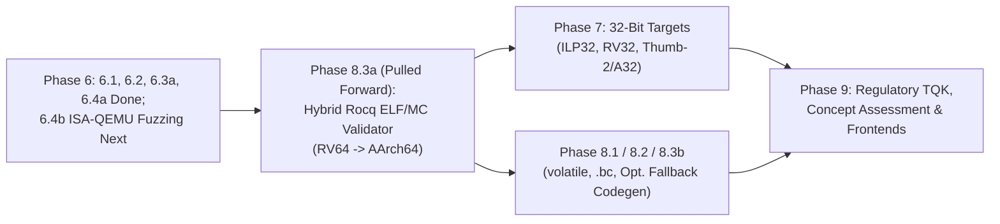

# Post-v1 Roadmap (`cert-llvm` Phases 6–9)

**Baseline:** Phases 1–5 Complete ([`README.md`](./README.md)); Wave 1–2 Live E2E Active (`rocq-ci.yml` Run `45237979180` at commit `c370e27`, `quality-gate.yml` Run `45237976937`, cross-repo `live-e2e.yml` Run `45240825208`: `8/8 (100.0%)` `mc` & `4/7 (57.1%)` `full` `fast_path_rocq_validated` + `mc_validated` on `aarch64` & `riscv64`, `EXACT (ocamlopt==ocamlc)`, `3-WAY MATCH` QEMU, `0` unproven IR optimizations)  
**Last Updated:** 2026-11-23

This roadmap defines the complete multi-phase plan closing remaining end-to-end verification, backend TCB closure, toolchain assurance, 32-bit targets, deep Rocq formalization, and regulatory qualification gaps beyond the v1 Middle-End baseline.

---

## Overview & Dependencies (**Weg A Execution Order**)

| Phase | Scope | Key Risk / TCB Closed | Dependency |
| :--- | :--- | :--- | :--- |
| **Phase 6** | **6.1, 6.2, 6.3a, 6.4a Done** (`live-e2e.yml`, LRAT Stage 3/4b, dual-compiler `34/34` forged + `230/230` mutation gate, `--require-mc-validated`); **6.4b** ISA-vs-QEMU fuzzing next; **6.3b** (`bisect_ppx`) & **6.4c** (Wave 3 `7/7` `full`) planned | Separates real LLVM `23.1.5` `-O2` telemetry; eliminates unchecked `Z3` UNSAT verdicts; qualifies `ocamlopt` output; hardens Rust ISA decoders before `8.3a` | Builds directly on v1 artifacts |
| **Phase 8.3a *(Pulled Forward)*** | **Hybrid Rocq ELF-to-IR Backend Validator (`cert-validator --check-mc`)**: `RV64IM+RVC` (`sail-riscv` reference) -> `AArch64` Core (`~4–8k` LOC vertical slice) | **Closes the last backend TCB gap:** removes ELF parser, A64/RV64 decoder, symbolic executor, and bit-blaster from the correctness TCB | Phase `6.2` LRAT + `6.4b` ISA fuzzing |
| **Phase 7** | `ILP32` core parameterization, `RISCV32` (`RV32IMAC`/`RV32GC`), `ARM Thumb-2` (`Cortex-M`/`R`) & optional `A32` | Unlocks 32-bit safety microcontrollers (`ELFCLASS32`, `SHT_REL`/`SHT_RELA`, 64-bit freestanding builtins) directly inheriting the `.mc.cert` + `McValidator.v` architecture | Phase `8.3a` vertical slice |
| **Phase 8 (Remaining)** | **8.1** Rocq `volatile`/MMIO ITree + verified `runtime/`, **8.2** Rocq `.bc` codec, **8.3b** optional minimal fallback codegen (commercial/private add-on evaluation) | Eliminates Menhir/Ocamllex, text `ir-bridge`, runtime C, and optionally `llc`/`ld.lld` fallback paths | Phase `8.3a` |
| **Phase 9** | Tool Qualification Kit (`TQK`), Concept Assessment, Stage-1 frontend traceability/formal validation, long-term Rust extraction evaluation | Audit-ready `ISO 26262-8` (`TCL3`/`ASIL D`), `IEC 61508` (`T3`/`SIL 3/4`), and `DO-178C`/`DO-330` compliance | Phase 6 + Phase `8.3a` (+ `8.3b` for `DAL A` OCV replacement) |

---

## Phase 6 — End-to-End Provability, Stage 4b TCB Closure & OCaml Validator Qualification

### 6.1 Cross-Repo Real-Toolchain E2E Verification Harness (`llvm-cert-enterprise`) *(Done)*
- **Outcome:** Live 8-binary pipeline (`clang 23` -> `opt 23 -O2` -> private SMT witness engine -> `cert-validator` / `verified-opt-fallback` -> `llc`/`ld.lld` -> `cert-backend-check` -> `.proof.json` -> `qemu-aarch64` / `qemu-riscv64`) verified in `live-e2e.yml` Run `45240825208`:
  - `e2e_corpus_mc.c` (`-O2`): **8/8 (100.0%)** `fast_path_rocq_validated` and **8/8 (100.0%)** `mc_validated` on both `aarch64` and `riscv64`, `EXACT (ocamlopt==ocamlc)`, `3-WAY MATCH` QEMU, `0` unproven IR optimizations.
  - `e2e_corpus_full.c` (`-O2`): **4/7 (57.1%)** `fast_path_rocq_validated` (`@voter_median3_i32`, `@helper_scale_i32`, `@saturating_add_u32`, `@pack_sensor_u64`) and **4/7 (57.1%)** `mc_validated`, strict `--require-mc-validated` fail-closed rejection verified, `EXACT (ocamlopt==ocamlc)`, `3-WAY MATCH` QEMU.

### 6.2 Eliminate Unchecked `Z3` from Stage 4b & Wire External LRAT Proofs in Stage 3 *(Done)*
- **Outcome:** Implemented total fail-closed DIMACS/LRAT verification (`validator/CertFormat.v`, `validator/AigLrat.v` `"Closed under the global context"`, CLI `--check-lrat` and Stage-3 `(lrat ...)` witness blocks within the `728/750` LOC handwritten OCaml TCB budget). Upgraded Stage 4b Tier 3 (`cert-backend-check`) to emit and verify machine-checkable UNSAT LRAT certificates via `cert-validator --check-lrat`. Zero paths rely on unchecked `Z3` `Unsat` verdicts.

### 6.3 OCaml Validator Toolchain Assurance (`ISO 26262-8 §11`)
Detailed technical baseline documented in [`ocaml-validator-qualification.md`](./ocaml-validator-qualification.md).
- **6.3a Dual-Compiler Parity, Certificate Mutation Suite & Artifact Packaging *(Done)*:**
  - Pinned OCaml `4.14.x`; `(modes native byte_complete)` builds both `ocamlopt` native and `ocamlc` bytecode binaries (`cert-validator` / `cert-validator.bc` and `verified-opt-fallback` / `verified-opt-fallback.bc`).
  - `34/34` forged-certificate cases (`run_forged_cert_suite.py`), `230/230` deterministic `.cert`/IR mutations (`100%` kill rate, `0` crashes/timeouts, `100%` native-vs.-bytecode parity), and `5/5` byte-identical `verified-opt-fallback` IR parity green in `rocq-ci.yml` Run `45237979180` and published to release `e2e-bundle-2026-11-22`.
- **6.3b Coverage Measurement & Pre-Release Bug Screening *(Planned)*:**
  - Add a separate non-release instrumentation build profile (`bisect_ppx`) measuring branch coverage of `cert-validator` across forged-cert, mutation, and E2E suites.
  - Maintain a pre-release `ocamlopt` x86_64 bug-tracker screening checklist archived alongside each tagged release manifest.

### 6.4 Backend Hardening, `McValidated` Coverage & Strict `ASIL D` Controls
- **6.4a Strict `--require-mc-validated` CLI Gate *(Done)*:**
  - Enforced in live CI (`live-e2e.yml`), accepting acyclic `mc` kernels (`8/8`) and failing closed with zero partial outputs when any function falls back to `ConstrainedBackendPinned`.
- **6.4b Randomized ISA-Semantics Differential Fuzzing (`cert-backend-check` vs. QEMU) *(Next — Weg A Step 1)*:**
  - **Goal:** Provide an immediate high-leverage safety net against instruction-decoder, flag-mask (e.g., `E-30`), and bit-width bugs in the Rust backend before Phase `8.3a` replaces the Rust checker with a Rocq proof gate.
  - **Deliverable:** Randomized valid-instruction / small-DAG generator in private `cert-qual-suite` comparing `cert-backend-check`'s decoded A64 & RV64 symbolic/concrete step semantics instruction-for-instruction against live `qemu-aarch64` and `qemu-riscv64` execution across randomized inputs and edge values (`0`, `-1`, `INT_MIN`, `INT_MAX`).
- **6.4c Structured Loops, SROA Stack Frames & Helper Calls (`Wave 3`) + `Safety Manual` *(Planned)*:**
  - Extend Fast-Path and backend cutpoint/call-summary reasoning to promote `@sroa_filter_step_i32`, `@checksum_loop_u32`, and `@composed_ctrl_i32` (`7/7` on `e2e_corpus_full.c`) and codify the two-tier `Safety Manual` rule (`McValidated` machine-checked evidence vs. `ConstrainedBackendPinned` target OCV per `ISO 26262-6 §9`).

---

## Phase 8.3a *(Pulled Forward Ahead of Phase 7)* — Hybrid Rocq ELF-to-IR Backend Validator (`cert-validator --check-mc`)

- **Honest TCB Gap Today:** Stage 2–3 IR translation validation (`CertValidator.v`, `ModuleMerge.v`) and Stage 4b `--check-lrat` SAT/UNSAT discharge (`AigLrat.v`) are formally proven in Rocq (`0 Admitted`). However, the ~`11.4k` LOC Rust ELF64 parser, A64/RV64 decoders, symbolic executor, and Tseitin bit-blaster in `cert-backend-check` remain unverified TCB code: `--check-lrat` proves only that an emitted CNF is UNSAT, not that the CNF faithfully represents `merged.ll` vs. the ELF `.text` machine instructions. Closing this link is required before claiming *"Rocq-proven from input IR down to ELF machine code."*
- **"Public Lock, Private Key-Maker" Split (`~4,000–8,000` LOC vertical slice):**
  - **Private Key-Maker (`llvm-cert-enterprise`):** `cert-backend-check` remains an untrusted witness generator emitting canonical `.mc.cert` files (ELF slice metadata, relocation/privilege checks, CFG cutpoints, register/stack-slot mappings, and LRAT proofs).
  - **Public Lock (`llvm-cert/validator/`):** New pure Rocq modules — `Elf64Spec.v` (bounds/relocation/symbol-slice validator), `McFormat.v` (`.mc.cert` parser & contract checks), `Rv64Sem.v`, `A64CoreSem.v`, and `McValidator.v` — verify `(merged.ll, out.o, .mc.cert)` end-to-end against Vellvm semantics using the existing zero-axiom `AigLrat.blast_refinement_cex_unsat_sound`, exposed via `cert-validator --check-mc` within the `750` LOC handwritten OCaml TCB budget.
- **Concrete Incremental Milestones:**
  1. **M1 — `RV64IM` + `RVC` Vertical Slice:** `Elf64Spec.v` + `McFormat.v` + `Rv64Sem.v` (aligned and cross-checked against official `sail-riscv` Rocq semantics) + `McValidator.v`, achieving **8/8 (100%)** end-to-end Rocq-proven IR-to-ELF validation on `e2e_corpus_mc.c` for `riscv64-unknown-none-elf`.
  2. **M2 — `AArch64` Core Vertical Slice:** `A64CoreSem.v` (~40–50 bare-metal integer, branch, NZCV flag, and fixed-frame load/store instructions validated instruction-by-instruction via `6.4b` QEMU differential fuzzing + official ISA test vectors, keeping a clean alignment path to ARM ASL / Isla models), achieving **8/8 (100%)** end-to-end Rocq-proven IR-to-ELF validation on `e2e_corpus_mc.c` for `aarch64-unknown-none-elf`.
  3. **M3 — Stack Frames, Loops & Calls:** Extend `.mc.cert` and `McValidator.v` alongside Phase `6.4c` (Wave 3) for stack-frame invariants, loop cutpoints, and verified call summaries.
- **Acceptance Criteria:** `0 Admitted`, `0` custom axioms, dual-compiler `ocamlopt == ocamlc` parity, adversarial forged-ELF / wrong-relocation / tampered-opcode rejection suite (`run_forged_mc_suite.py`), completely removing `cert-backend-check` from the correctness TCB for `McValidated` functions.

---

## Phase 7 — 32-Bit Embedded Targets (`ILP32`, `RISCV32`, `ARM Thumb-2` / `A32`) *(After `8.3a`)*

Scheduled directly *after* Phase `8.3a` so 32-bit targets inherit the `.mc.cert` + `McValidator.v` backend-proof architecture cleanly on day one instead of retrofitting 4 architectures later. Architectural feasibility rests on `{IP : IPtr} {IPT : IPtrTheory}` genericity (~80–85% of pass/validator Rocq logic already width-parametric).

### 7.1 Shared `ILP32` Foundation (~2,500–3,500 LOC)
- **Rocq Semantics & Validators:** Parameterize `Sizeof.v` (`ptr_bytes ∈ {4, 8}`, `DTYPE_Pointer`/`DTYPE_Iptr` width `32` vs. `64`, `i64:64` ABI alignment matching both `RV32` and `AAPCS32`), instantiate `IP32Bit` in `IPtrFinite.v`, parameterize `SizeofV`/`ParamsV.v` & `Theory/I2F/`, generalize `wrap_ptr64` in `CertValidator.v`, and instantiate 32-bit soundness theorems in `ModuleMerge.v` plus `ELFCLASS32` support in `Elf64Spec.v` / `ElfSpec.v`.
- **SMT, ELF32 & Runtime:**
  - Make pointer and GEP index widths DataLayout-driven in the private SMT witness engine.
  - Add `ELFCLASS32` parsing plus both `SHT_REL` and `SHT_RELA` handling in `cert-backend-check/src/elf.rs`.
  - Implement CERT-C/MISRA-compliant 64-bit freestanding runtime builtins (`__udivdi3`, `__umoddi3`, `__ashldi3`, `__lshrdi3`, `__aeabi_*`) in `runtime/` and allowlist them in `APPROVED_CERT_RUNTIME_BUILTINS`.
  - Enable validated `ilp32` triples in `cert-llvm/src/safety_profile.rs`.

### 7.2 `RISCV32` (`RV32IMAC` / `RV32GC`, ~800–1,200 LOC)
- **Compiler Base:** Reuse existing `llvm/lib/Target/RISCV` (`clang`, `llc`, `ld.lld` already support RV32).
- **Decoder, Symbolic Check & Testing:** Extend `riscv64.rs` / `symbolic.rs` (and `Rv32Sem.v`) for `XLEN = 32`, `lw`/`sw` spills, RVC differences (`funct3 = 001` quadrant `01` `c.jal` writing `ra` vs. RV64 `c.addiw`; `c.flw`/`c.fsw` vs. `c.ld`/`c.sd`), `ilp32` ABI (`16B` `sp`, `a0` `sret`, register pairs for `i64`), `mc_exec`, and `qemu-riscv32`.

### 7.3 `ARM Thumb-2` (`Cortex-M4/M7/M33/R52`, ~3,500–5,000 LOC) & Optional `A32` (+1,200–1,800 LOC)
- **Upstream Target Restore:** Re-import `llvm/lib/Target/ARM` and `clang/lib/Basic/Targets/ARM*` from pinned `llvmorg-23.1.5` (`392dfff97d29b59d77e5cac6d4b6ef2585fe7117`, committed with `[allow-upstream-patch]`).
- **Thumb-2 (`T32`) Support:** Build `thumb2.rs` covering mixed 16/32-bit encodings, explicit `APSR.NZCV` flags, `IT` conditional blocks, barrel-shifter operands, multi-register `push`/`pop`/`ldm`/`stm`, and Thumb interworking bit (`addr | 1`). Enforce `AAPCS32` (`8B` `sp`, `r0` `sret` shifting scalar args to `r1..r3`), `SHT_REL` `R_ARM_THM_CALL`/`R_ARM_THM_JUMP24` J1/J2 bit-decoding + veneer checks, `__aeabi_*` builtins, `mc_exec`, and `qemu-arm`.
- **Optional `A32` (`ARMv7-R/A`):** Add fixed-width 32-bit `arm32.rs` decoder reusing the `APSR.NZCV` and `AAPCS32` semantics from Thumb-2.

---

## Phase 8 *(Remaining Deep Formal Closure: `8.1`, `8.2`, Optional `8.3b`)*

Moves residual Zone A/B components (`llvm_parser`, `ir-bridge`, `runtime/`, and optionally `llc`/`ld.lld` fallback) out of the TCB without rewriting LLVM C++.

### 8.1 `volatile`/MMIO & Runtime Builtins in Rocq (~2,000–4,000 LOC)
- **Observable `volatile` / MMIO Semantics (~1k–2k LOC):** Extend `LLVMEvents.v` / `Denotation.v` so `ANN_volatile` loads/stores emit ordered observable ITree events, proving that neither passes nor translation validation reorder, coalesce, or drop hardware register accesses.
- **Verified Freestanding Runtime (~1k–2k LOC):** Lower the ~15 freestanding `runtime/` functions (`memcpy`, `memset`, `__udivti3`, 64-bit helpers) to IR/ELF and formally prove each against its exact mathematical specification in Rocq.

### 8.2 Verified LLVM Bitcode (`.bc`) Reader/Writer in Rocq (~3,000–5,000 LOC)
- Implement a total, Rocq-verified LLVM bitcode reader/writer analogous to `CertFormat.v`, eliminating the unverified Menhir/Ocamllex textual surface parser (`llvm_parser.mly`/`llvm_lexer.mll`) and text `ir-bridge` parsing/printing from Zone A.

### 8.3b Optional Minimal Verified Fallback Codegen (~8,000–12,000 LOC, Commercial Add-On Evaluation)
- **Role:** Provide a simple, predictable `MCFG -> AArch64/RISC-V` fallback code generator only for the ~2–5% of functions failing `.mc.cert` synthesis under `8.3a`, removing `llc` and `ld.lld` completely even on complex fallback paths (and unlocking `DO-178C DAL A` without target OCV).
- **Open-Core IP Guardrail:** Unlike pure proof *checkers* (`cert-validator`, `McValidator.v`) — which are useless to copycats without the private witness engine — a standalone verified code generator would turn `clang -O0 -> verified-opt-fallback -> verified-codegen` into a self-contained open-source compiler clone. Keep `8.3b` deferred and evaluate housing its generator/emission logic as a private commercial Enterprise module rather than publishing turnkey codegen directly in the public repo.

---

## Phase 9 — Regulatory Qualification, Frontend Verification & Long-Term Architecture

### 9.1 Tool Qualification Kit (`TQK`) & TÜV Concept Assessment
- Package the 4-stage architecture dossier, Safety Manual, `.proof.json` specification, `verify_repo_integrity.py` / `CheckAssumptions.v` evidence, and qualification suite reports for an independent **Concept Assessment** (`ISO 26262-8 §11`) ahead of customer pilot qualification.
- Target positioning by domain:
  - **Automotive (`ISO 26262-8 §11`):** `TCL1` for `opt -O2` and `Z3` (via fail-closed `cert-validator` detection `TD1`), `TCL3` for pinned `clang`/`llc`/`cert-llvm` up to **`ASIL D`**.
  - **Industrial / Rail / Medical (`IEC 61508`, `EN 50128`, `IEC 62304`):** `T3` up to **`SIL 3 / SIL 4`** / Software Class C.
  - **Avionics (`DO-178C` / `DO-330` / `DO-333`):** **`DAL C / B`** cleanly supported, with `cert-validator` positioned as a **`TQL-5`** verification tool (and `DAL A` OCV replacement gated on Phase 8.3).

### 9.2 Stage-1 Frontend Qualification & Formal `Source -> IR` Validation
- **Short/Medium-Term (`TCL3` Traceability):** Build a formal requirement-to-test traceability matrix over `SafetyDriverProfile` (`SuperTest` mapping for MISRA-C / C17; Ferrocene Language Specification mapping for Rust) supplementing `stage1_conformance.c` and `cert-qual-suite`.
- **Long-Term Formal Frontend Check (~15,000–25,000 LOC):** Validate `C-AST -> input.ll` against a formal C11/C17 semantics (`Cerberus` or `CompCert Clight`, matching LLVM `-O2` speed rather than CompCert codegen) and `Rust MIR -> input.ll` (`MiniRust`/`Charon`), removing even `clang -O0` from the correctness TCB for C and Rust.

### 9.3 Long-Term Rust Extraction Evaluation
- Keep proven **OCaml extraction** throughout Concept Assessment and v1 qualification (proven CompCert/DO-178C audit precedent, decades-mature extractor, clean physical process isolation `TD1` between Rust orchestrator and OCaml checker).
- Re-evaluate `rocq-rust-extraction` (compiled via a qualified Rust toolchain such as Ferrocene) only *after* v1 Concept Assessment once extractor maturity and arena/performance behavior on `AigLrat.v` match OCaml extraction without introducing new audit risk.

---

## Explicit Long-Term Architectural Boundaries

These domains remain outside the formal end-to-end scope and are addressed through explicit gates or customer system-level verification:
1. **Full Modern C++ (`C++20/23`) Frontend Formalization:** No complete formal semantics exists for full ISO C++; `clang++ -O0` remains part of the frontend TCB while everything from `input.ll` downward can still be formally checked.
2. **Multicore Weak-Memory Atomics (`Acquire`/`Release`/`SeqCst`):** Weak-memory concurrency (`Promising-LLVM`/`IMM`) across optimizations and hardware backends remains blocked by hard `cfg_no_concurrency` / Safe-Path gates rather than silently miscompiled.
3. **Hardware Silicon & Timing Assurance:** Compiler proofs establish ISA semantic conformance; CPU silicon errata, cache/timing side channels, and worst-case execution time (`WCET`) require dedicated hardware and timing verification layers.
