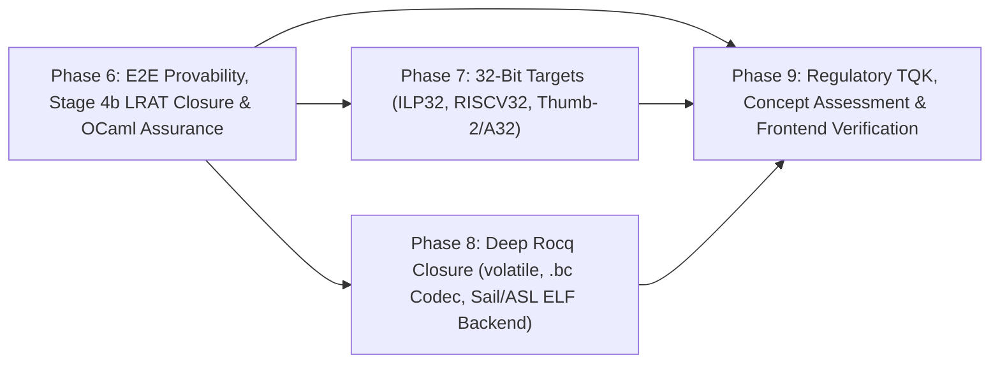

# Post-v1 Roadmap (`cert-llvm` Phases 6–9)

**Baseline:** Phases 1–5 Complete ([`README.md`](./README.md); green `Rocq 9.1 Formal Verification & Extraction CI` Run `44586271407` at commit `fbae024`, `Fast Quality, License & Integrity Gate` Run `45075220822`)  
**Last Updated:** 2026-11-22

This roadmap defines the complete multi-phase plan closing remaining end-to-end verification, toolchain assurance, 32-bit target, deep Rocq formalization, and regulatory qualification gaps beyond the v1 Middle-End baseline.

---

## Overview & Dependencies

| Phase | Scope | Key Risk / TCB Closed | Dependency |
| :--- | :--- | :--- | :--- |
| **Phase 6** | Cross-repo E2E harness, Stage 3/4b LRAT discharge, OCaml dual-compiler/mutation assurance, strict `McValidated` controls | Separates real LLVM `23.1.5` `-O2` telemetry; removes unchecked `Z3` from Stage 4b; qualifies `ocamlopt` output; caps `ConstrainedBackendPinned` | Builds directly on v1 artifacts |
| **Phase 7** | `ILP32` core parameterization, `RISCV32` (`RV32IMAC`/`RV32GC`), `ARM Thumb-2` (`Cortex-M`/`R`) & optional `A32` | Unlocks 32-bit safety microcontrollers (`ELFCLASS32`, `SHT_REL`/`SHT_RELA`, 64-bit freestanding builtins) | Phase 6.1 harness |
| **Phase 8** | Rocq `volatile`/MMIO ITree semantics, verified `runtime/` builtins, Rocq `.bc` codec, Sail/ASL ELF validator + fallback codegen | Eliminates `llc`, `ld.lld`, Menhir/Ocamllex, text `ir-bridge`, and runtime C from the TCB | Phase 6.2 LRAT pipeline |
| **Phase 9** | Tool Qualification Kit (`TQK`), Concept Assessment, Stage-1 frontend traceability/formal validation, long-term Rust extraction evaluation | Audit-ready `ISO 26262-8` (`TCL3`/`ASIL D`), `IEC 61508` (`T3`/`SIL 3/4`), and `DO-178C`/`DO-330` compliance | Phase 6 (+ Phase 8 for `DAL A` OCV replacement) |

---

## Phase 6 — End-to-End Provability, Stage 4b TCB Closure & OCaml Validator Qualification

### 6.1 Cross-Repo Real-Toolchain E2E Verification Harness (`llvm-cert-enterprise`)
- **Goal:** Replace isolated CI mocks with a reproducible end-to-end pipeline exercising the real prebuilt `LLVM 23.1.5` SDK (`llvm-cert-sdk-23.1.5-linux-x86_64`) alongside the real Rocq-extracted `llvm-cert-rocq-tools-linux-x86_64` binaries (`cert-validator`, `verified-opt-fallback`).
- **Pipeline Exercised:**
  `Customer C -> clang 23 -O0 -> opt 23 -O2 -> cert-z3-engine -> cert-validator / verified-opt-fallback -> llc / ld.lld -> cert-backend-check -> .proof.json -> qemu-aarch64 / qemu-riscv64`
- **Deliverables & Acceptance Criteria:**
  - Dedicated CI/integration job downloading both release/CI artifacts and executing the embedded C corpus + differential kernels end-to-end.
  - Emits empirical telemetry for real `-O2` workloads: `Fast-Path %` vs. `Safe-Path %`, `McValidated %` vs. `ConstrainedBackendPinned %`, end-to-end compilation latency, and bit-exact `qemu-aarch64` / `qemu-riscv64` digest parity against `clang -O0`.

### 6.2 Eliminate Unchecked `Z3` from Stage 4b & Wire External LRAT Proofs in Stage 3
- **Current Gap:** While Stage 3 uses `cert-validator` in Rocq, `CertValidator.check_cert_defn` currently passes `None` for `opt_pf` (relying on built-in algebraic rules + bounded DPLL), and Stage 4b `cert-backend-check` Tier 3 (`symbolic.rs`) still trusts raw `Z3` `Unsat` verdicts directly without Rocq proof checking.
- **Work Packages:**
  1. **Rocq LRAT Parser & Stage 3 Wiring (`validator/`):** Implement total fail-closed `parse_lrat` in `validator/CertFormat.v`, wire optional `(lrat ...)` witness blocks into `CertValidator.validate_tle_pair_with_cert_str`, and add a minimal CLI mode (`--check-lrat` / `--check-bv-lrat`) in `vellvm/src/ml/bin/cert_validator.ml` while remaining strictly within the `750` LOC handwritten OCaml TCB budget.
  2. **Stage 4b LRAT Proof Discharge (`llvm-cert-enterprise/crates/cert-backend-check`):** Upgrade Tier 3 (`symbolic.rs`) so bit-vector equivalence queries generate or check machine-verifiable UNSAT LRAT certificates via `AigLrat.check_lrat_unsat` (`"Closed under the global context"`), lowering `Z3` to `TD1 -> TCL1` in the backend as well.
- **Acceptance Criteria:** Zero paths in `cert-llvm` depend on trusting an unchecked `Z3` `Unsat` verdict for correctness claims; negative malformed/forged LRAT regression tests pass cleanly.

### 6.3 OCaml Validator Toolchain Assurance (`ISO 26262-8 §11`)
Detailed technical baseline documented in [`ocaml-validator-qualification.md`](./ocaml-validator-qualification.md).
- **6.3a Dual-Compiler Parity, Certificate Mutation Suite & Artifact Packaging *(Done)*:**
  - Pin OCaml `4.14.x` switch; enable `(modes native byte_complete)` in [`vellvm/src/ml/bin/dune`](../vellvm/src/ml/bin/dune) to build both `ocamlopt` native binaries and standalone `ocamlc` bytecode binaries (`cert-validator` / `cert-validator.bc` and `verified-opt-fallback` / `verified-opt-fallback.bc`).
  - Run deterministic dual-compiler parity (`28/28` forged-cert cases + `verified-opt-fallback` byte-exact IR determinism) and `>= 200` deterministic `.cert`/IR mutations (`scripts/run_cert_mutation_suite.py`, `100%` kill rate, `0` crashes/timeouts, `100%` native-vs.-bytecode exit-code equality) inside `rocq-ci.yml`.
  - Publish `llvm-cert-rocq-tools-linux-x86_64.tar.zst` with `SHA256SUMS.txt` and `TOOLCHAIN.txt`.
- **6.3b Coverage Measurement & Pre-Release Bug Screening *(Planned)*:**
  - Add a separate non-release instrumentation build profile (`bisect_ppx`) measuring branch coverage of `cert-validator` across the forged-cert + mutation + E2E suites.
  - Maintain a pre-release `ocamlopt` x86_64 bug-tracker screening checklist and archive it alongside each tagged release manifest.

### 6.4 Backend `McValidated` Coverage & Strict `ASIL D` Controls
- **Work Packages:**
  1. Add `--require-mc-validated` strict CLI gate in `cert-llvm`, failing closed whenever any function drops to `ConstrainedBackendPinned`.
  2. Codify the two-tier `Safety Manual` rule: `McValidated` functions carry machine-checked IR-to-MC proof evidence in `.proof.json`; `ConstrainedBackendPinned` functions require explicit user-level back-to-back/target OCV testing per `ISO 26262-6 §9`.
  3. Extend `cert-backend-check` symbolic equivalence (`symbolic.rs`) with loop cutpoints and structured call-summary reasoning to raise `McValidated` coverage on real embedded firmware containing loops and helper calls.
- **Acceptance Criteria:** `--require-mc-validated` enforced in CI on acyclic safety kernels and documented in TQK; structured loop kernels promoted from `ConstrainedBackendPinned` to `McValidated`.

---

## Phase 7 — 32-Bit Embedded Targets (`ILP32`, `RISCV32`, `ARM Thumb-2` / `A32`)

Architectural feasibility rests on `{IP : IPtr} {IPT : IPtrTheory}` genericity (~80–85% of pass/validator Rocq logic already width-parametric).

### 7.1 Shared `ILP32` Foundation (~2,500–3,500 LOC)
- **Rocq Semantics & Validators:** Parameterize `Sizeof.v` (`ptr_bytes ∈ {4, 8}`, `DTYPE_Pointer`/`DTYPE_Iptr` width `32` vs. `64`, `i64:64` ABI alignment matching both `RV32` and `AAPCS32`), instantiate `IP32Bit` in `IPtrFinite.v`, parameterize `SizeofV`/`ParamsV.v` & `Theory/I2F/`, generalize `wrap_ptr64` in `CertValidator.v`, and instantiate 32-bit soundness theorems in `ModuleMerge.v`.
- **SMT, ELF32 & Runtime:**
  - Make pointer and GEP index widths DataLayout-driven in `cert-z3-engine` (`ir_model.rs`, `smt.rs`).
  - Add `ELFCLASS32` parsing plus both `SHT_REL` and `SHT_RELA` handling in `cert-backend-check/src/elf.rs`.
  - Implement CERT-C/MISRA-compliant 64-bit freestanding runtime builtins (`__udivdi3`, `__umoddi3`, `__ashldi3`, `__lshrdi3`, `__aeabi_*`) in `runtime/` and allowlist them in `APPROVED_CERT_RUNTIME_BUILTINS`.
  - Enable validated `ilp32` triples in `cert-llvm/src/safety_profile.rs`.

### 7.2 `RISCV32` (`RV32IMAC` / `RV32GC`, ~800–1,200 LOC)
- **Compiler Base:** Reuse existing `llvm/lib/Target/RISCV` (`clang`, `llc`, `ld.lld` already support RV32).
- **Decoder, Symbolic Check & Testing:** Extend `riscv64.rs` / `symbolic.rs` for `XLEN = 32`, `lw`/`sw` spills, RVC differences (`funct3 = 001` quadrant `01` `c.jal` writing `ra` vs. RV64 `c.addiw`; `c.flw`/`c.fsw` vs. `c.ld`/`c.sd`), `ilp32` ABI (`16B` `sp`, `a0` `sret`, register pairs for `i64`), `mc_exec`, and `qemu-riscv32`.

### 7.3 `ARM Thumb-2` (`Cortex-M4/M7/M33/R52`, ~3,500–5,000 LOC) & Optional `A32` (+1,200–1,800 LOC)
- **Upstream Target Restore:** Re-import `llvm/lib/Target/ARM` and `clang/lib/Basic/Targets/ARM*` from pinned `llvmorg-23.1.5` (`392dfff97d29b59d77e5cac6d4b6ef2585fe7117`, committed with `[allow-upstream-patch]`).
- **Thumb-2 (`T32`) Support:** Build `thumb2.rs` covering mixed 16/32-bit encodings, explicit `APSR.NZCV` flags, `IT` conditional blocks, barrel-shifter operands, multi-register `push`/`pop`/`ldm`/`stm`, and Thumb interworking bit (`addr | 1`). Enforce `AAPCS32` (`8B` `sp`, `r0` `sret` shifting scalar args to `r1..r3`), `SHT_REL` `R_ARM_THM_CALL`/`R_ARM_THM_JUMP24` J1/J2 bit-decoding + veneer checks, `__aeabi_*` builtins, `mc_exec`, and `qemu-arm`.
- **Optional `A32` (`ARMv7-R/A`):** Add fixed-width 32-bit `arm32.rs` decoder reusing the `APSR.NZCV` and `AAPCS32` semantics from Thumb-2.

---

## Phase 8 — Deep Formal Closure in Rocq (Eliminating Remaining `llc`/`ld.lld`/Surface TCB)

Moves residual Zone A/B components (`llc`, `ld.lld`, `llvm_parser`, `ir-bridge`, `runtime/`) out of the TCB without rewriting LLVM C++.

### 8.1 `volatile`/MMIO & Runtime Builtins in Rocq (~2,000–4,000 LOC)
- **Observable `volatile` / MMIO Semantics (~1k–2k LOC):** Extend `LLVMEvents.v` / `Denotation.v` so `ANN_volatile` loads/stores emit ordered observable ITree events, proving that neither passes nor translation validation reorder, coalesce, or drop hardware register accesses.
- **Verified Freestanding Runtime (~1k–2k LOC):** Lower the ~15 freestanding `runtime/` functions (`memcpy`, `memset`, `__udivti3`, 64-bit helpers) to IR/ELF and formally prove each against its exact mathematical specification in Rocq.

### 8.2 Verified LLVM Bitcode (`.bc`) Reader/Writer in Rocq (~3,000–5,000 LOC)
- Implement a total, Rocq-verified LLVM bitcode reader/writer analogous to `CertFormat.v`, eliminating the unverified Menhir/Ocamllex textual surface parser (`llvm_parser.mly`/`llvm_lexer.mll`) and text `ir-bridge` parsing/printing from Zone A.

### 8.3 Rocq ELF-to-IR Backend Validator (`Sail`/`ASL`) + Minimal Rocq Fallback Codegen (~20,000–30,000 LOC)
- **Architecture:** Convert `cert-backend-check` into an untrusted witness generator emitting `.mc.cert` (stack-slot mappings, register assignments, cutpoints, and LRAT proofs).
- **In-Rocq ELF Checker:** Verify linked ELF64/ELF32 `.text` + relocation invariants directly against official manufacturer-backed Rocq ISA semantics (`Sail`/`ASL` for AArch64 and `sail-riscv` for RISC-V) using `AigLrat.v`, proving `ELF_MachineCode ⊑ Vellvm_IR`.
- **Minimal Verified Fallback Codegen (~8k–12k LOC):** Provide a simple, predictable Rocq `MCFG -> AArch64/RISC-V` fallback code generator for the ~2–5% of functions failing `.mc.cert` synthesis, removing `llc` and `ld.lld` completely from the correctness TCB (and unlocking `DO-178C DAL A` without target OCV for `McValidated` binaries).

---

## Phase 9 — Regulatory Qualification, Frontend Verification & Long-Term Architecture

### 9.1 Tool Qualification Kit (`TQK`) & TÜV Concept Assessment
- Package the 4-stage architecture dossier, Safety Manual, `.proof.json` specification, `verify_repo_integrity.py` / `CheckAssumptions.v` evidence, and qualification suite reports for an independent **Concept Assessment** (`ISO 26262-8 §11`) ahead of customer pilot qualification.
- Target positioning by domain:
  - **Automotive (`ISO 26262-8 §11`):** `TCL1` for `opt -O2` and `Z3` (via fail-closed `cert-validator` detection `TD1`), `TCL3` for pinned `clang`/`llc`/`cert-llvm` up to **`ASIL D`**.
  - **Industrial / Rail / Medical (`IEC 61508`, `EN 50128`, `IEC 62304`):** `T3` up to **`SIL 3 / SIL 4`** / Software Class C.
  - **Avionics (`DO-178C` / `DO-330` / `DO-333`):** **`DAL C / B`** cleanly supported, with `cert-validator` positioned as a **`TQL-5`** verification tool (and `DAL A` OCV replacement gated on Phase 8.3).

### 9.2 Stage-1 Frontend Qualification & Formal `Source -> IR` Validation
- **Short/Medium-Term (`TCL3` Traceability):** Build a formal requirement-to-test traceability matrix over `SafetyDriverProfile` (`SuperTest` mapping for MISRA-C / C17; Ferrocene Language Specification mapping for Rust) supplementing `stage1_conformance.c` and `cert-qual-suite`.
- **Long-Term Formal Frontend Check (~15,000–25,000 LOC):** Validate `C-AST -> input.ll` against a formal C11/C17 semantics (`Cerberus` or `CompCert Clight`, matching LLVM `-O2` speed rather than CompCert codegen) and `Rust MIR -> input.ll` (`MiniRust`/`Charon`), removing even `clang -O0` from the correctness TCB for C and Rust.

### 9.3 Long-Term Rust Extraction Evaluation
- Keep proven **OCaml extraction** throughout Concept Assessment and v1 qualification (proven CompCert/DO-178C audit precedent, decades-mature extractor, clean physical process isolation `TD1` between Rust orchestrator and OCaml checker).
- Re-evaluate `rocq-rust-extraction` (compiled via a qualified Rust toolchain such as Ferrocene) only *after* v1 Concept Assessment once extractor maturity and arena/performance behavior on `AigLrat.v` match OCaml extraction without introducing new audit risk.

---

## Explicit Long-Term Architectural Boundaries

These domains remain outside the formal end-to-end scope and are addressed through explicit gates or customer system-level verification:
1. **Full Modern C++ (`C++20/23`) Frontend Formalization:** No complete formal semantics exists for full ISO C++; `clang++ -O0` remains part of the frontend TCB while everything from `input.ll` downward can still be formally checked.
2. **Multicore Weak-Memory Atomics (`Acquire`/`Release`/`SeqCst`):** Weak-memory concurrency (`Promising-LLVM`/`IMM`) across optimizations and hardware backends remains blocked by hard `cfg_no_concurrency` / Safe-Path gates rather than silently miscompiled.
3. **Hardware Silicon & Timing Assurance:** Compiler proofs establish ISA semantic conformance; CPU silicon errata, cache/timing side channels, and worst-case execution time (`WCET`) require dedicated hardware and timing verification layers.
